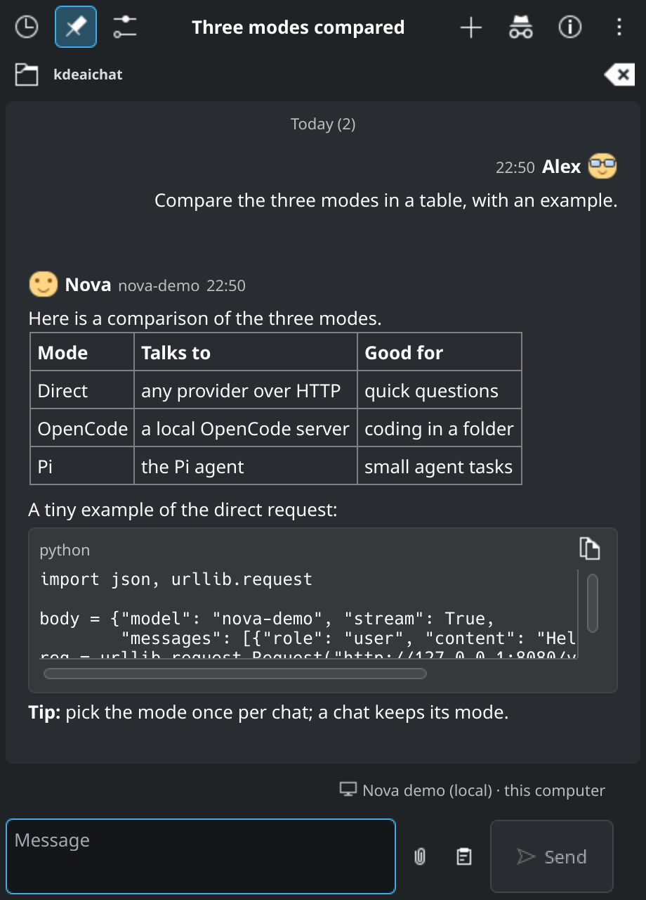
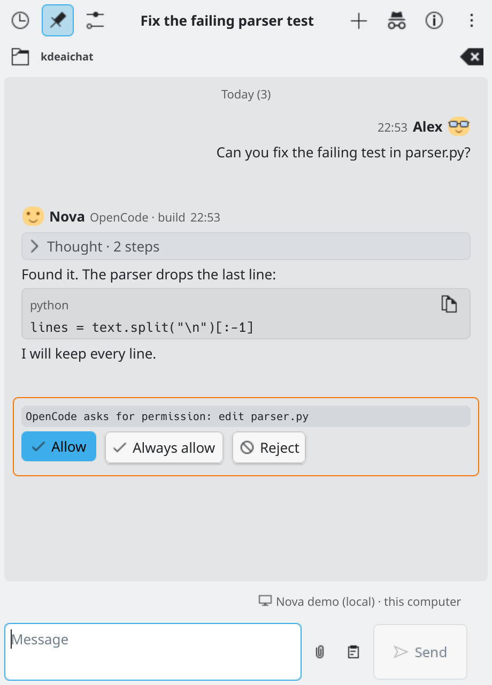
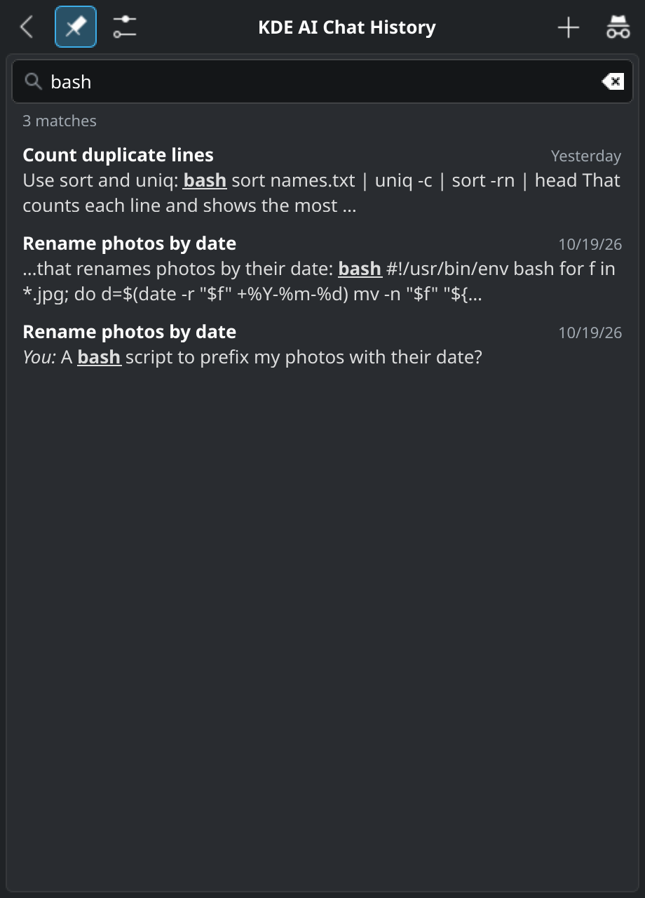
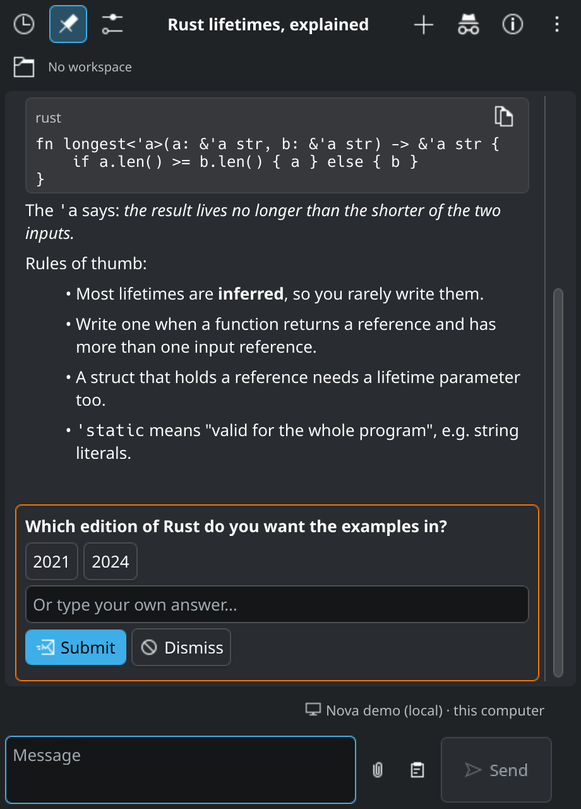
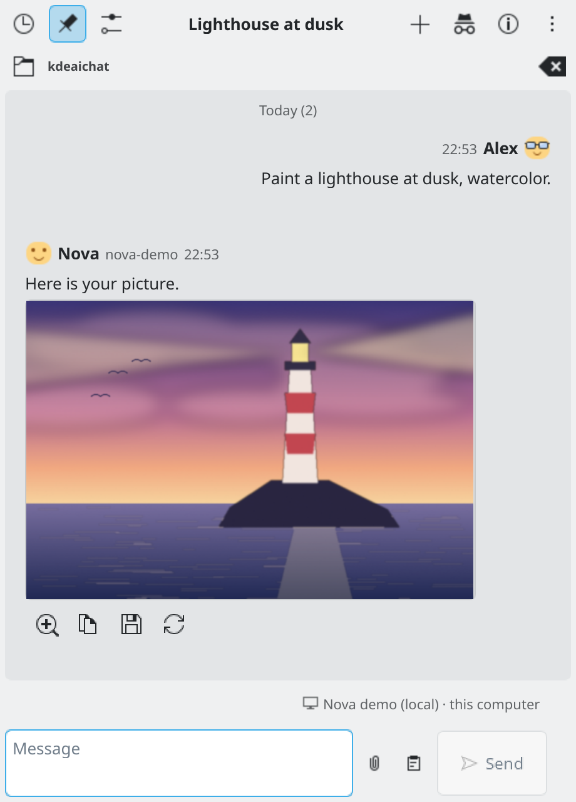
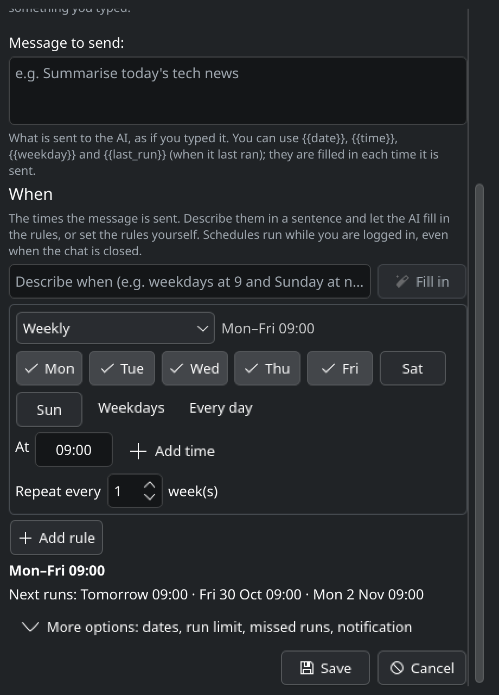
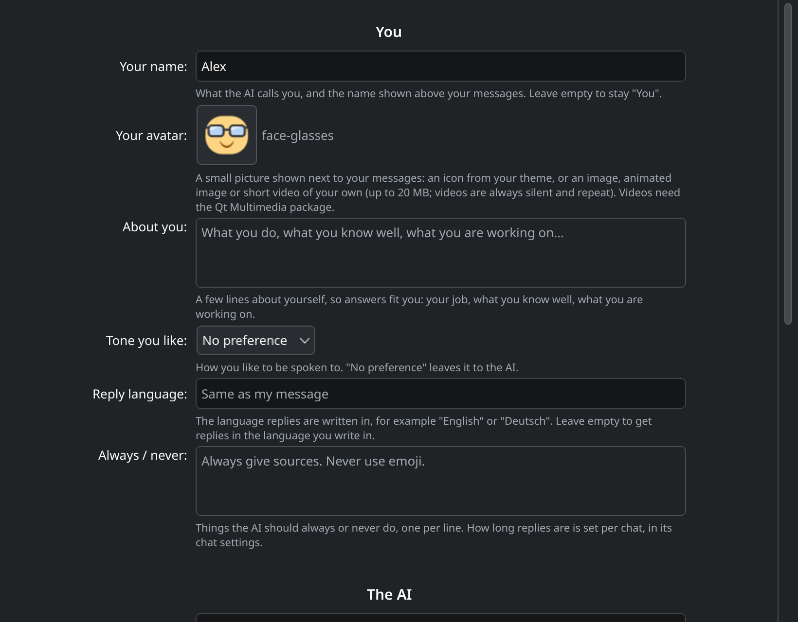
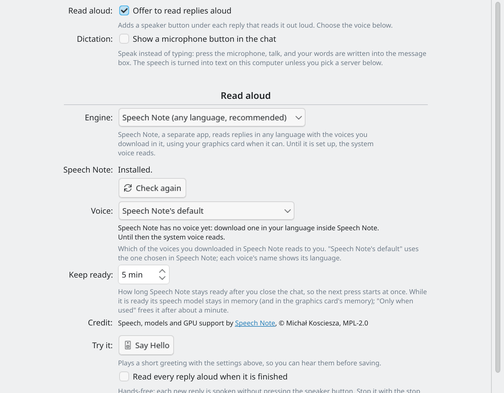
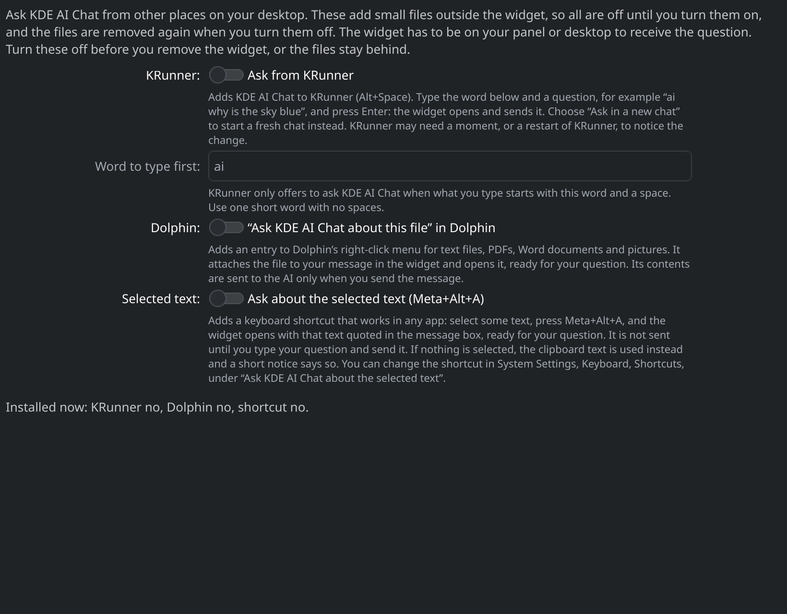
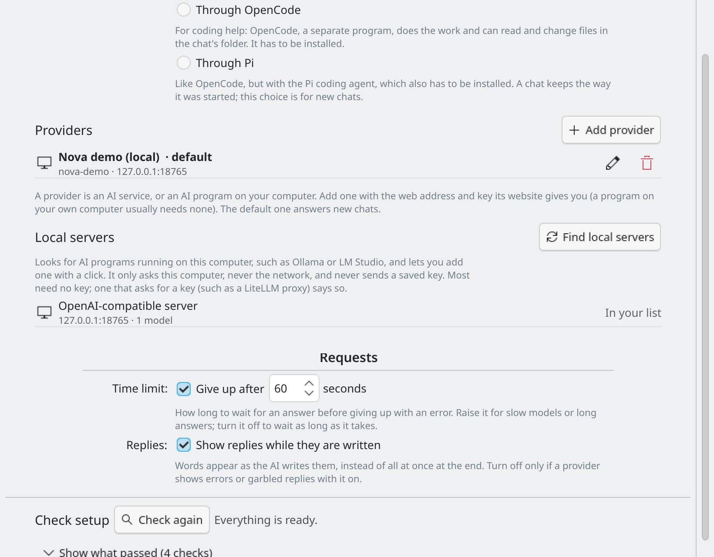

# KDE AI Chat

[](https://store.kde.org/p/2360152/) [](https://github.com/racstan/KDE-AI-Chat/releases)

A chat assistant that lives on your **KDE Plasma 6** desktop. Talk to the AI service of your choice, or to a model running on your own computer. Drop in files, keep your chats in projects, schedule messages, and let the AI help with code. Your API keys are kept in KDE Wallet, and your chats stay in private files on your computer.

[](https://youtu.be/SnkKFCN_Jkg)

[Watch the full tour on YouTube](https://youtu.be/SnkKFCN_Jkg) (13 min)


---

## Screenshots

<table>
<tr><td align="center" width="33%"><br><sub>A conversation</sub></td><td align="center" width="33%"><br><sub>Tables and code (dark theme)</sub></td><td align="center" width="33%"><br><sub>OpenCode agent with permissions</sub></td></tr>
<tr><td align="center" width="33%"><br><sub>Chat history and projects</sub></td><td align="center" width="33%"><br><sub>Search across all chats</sub></td><td align="center" width="33%"><br><sub>Incognito chats</sub></td></tr>
<tr><td align="center" width="33%"><br><sub>Slash commands</sub></td><td align="center" width="33%"><br><sub>The AI can ask you</sub></td><td align="center" width="33%"><br><sub>Pictures with /image</sub></td></tr>
<tr><td align="center" width="33%"><br><sub>Chat info and per-chat settings</sub></td><td align="center" width="33%"><br><sub>Scheduled messages</sub></td><td align="center" width="33%"><br><sub>First-run setup</sub></td></tr>
<tr><td align="center" width="33%"><br><sub>Providers and local servers</sub></td><td align="center" width="33%"><br><sub>Personality and avatars</sub></td><td align="center" width="33%"><br><sub>Memory</sub></td></tr>
<tr><td align="center" width="33%"><br><sub>Voice with Speech Note</sub></td><td align="center" width="33%"><br><sub>KRunner, Dolphin, selected text</sub></td><td align="center" width="33%"><br><sub>Check setup</sub></td></tr>
</table>

Short clips: [sending a message](docs/media/send-message.gif) · [search](docs/media/search.gif) · [incognito](docs/media/incognito.gif) · [slash commands](docs/media/commands.gif). Every screenshot comes in a light and a dark version in [docs/media](docs/media).

---

## What it does

- **Many AI providers.** OpenAI, Anthropic, Google Gemini, OpenRouter, Groq, Mistral and more, plus local programs such as Ollama and LM Studio. It can find local servers for you. See [Providers](docs/providers.md).
- **Three ways to chat.** Directly to a provider, through the OpenCode coding agent, or through the Pi coding agent. See [Modes](docs/modes.md).
- **Chats that stay organised.** History, search across all chats, projects, incognito chats, quotes, edit and rewind, slash commands, export. See [Chats](docs/chats.md).
- **Memory and personality.** Tell the AI who you are and what to remember. See [Memory and personality](docs/memory-and-personality.md).
- **Scheduled messages.** Send a message into a chat at set times, even when the widget is closed. See [Schedules](docs/schedules.md).
- **Pictures.** Make pictures with `/image` through AI Horde or Pollinations, and see pictures that models send back. See [Pictures](docs/pictures.md).
- **Voice.** Dictate instead of typing and have replies read aloud. Both are off until you switch them on. See [Voice](docs/voice.md).
- **Desktop integration.** Ask from KRunner, from Dolphin, or about selected text in any app. See [Desktop integration](docs/desktop-integration.md).
- **Your look.** Text size, bubbles, accent colour, an icon or animation in the panel, avatars. See [Customising](docs/customising.md).
- **Private by design.** See [Privacy](docs/privacy.md) for what is stored where and what is sent where.

---

## Installation

### Option 1: From the desktop (recommended)
1. Right-click the desktop or a panel and choose **Add Widgets...**
2. Click **Get New Widgets** and then **Download New Plasma Widgets...**
3. Search for **KDE AI Chat** and click **Install**.

### Option 2: Download the file
1. Get the `.plasmoid` file from the [KDE Store](https://store.kde.org/p/2360152/) or the [GitHub releases](https://github.com/racstan/KDE-AI-Chat/releases).
2. Install it in a terminal:
   ```bash
   kpackagetool6 -i /path/to/downloaded-package.plasmoid
   ```

### Option 3: From the source code
```bash
git clone https://github.com/racstan/KDE-AI-Chat.git
cd KDE-AI-Chat
./install.sh
systemctl --user restart plasma-plasmashell.service
```
Then right-click the desktop or a panel, choose **Add Widgets...** and add **KDE AI Chat**.

The first time you open the chat, a short setup card helps you choose where your AI runs. More in [Getting started](docs/getting-started.md).

---

## System dependencies

The widget works out of the box. Some features need a small tool; if one is missing, the widget tells you what to install, and **Settings → Connection → Check setup** lists it too.

| Feature | Tool needed | Debian/Ubuntu | Arch Linux | Fedora |
| :--- | :--- | :--- | :--- | :--- |
| **Reading PDFs** | `pdftotext` | `sudo apt install poppler-utils` | `sudo pacman -S poppler` | `sudo dnf install poppler-utils` |
| **Reading Word documents** (better results) | `pandoc` | `sudo apt install pandoc` | `sudo pacman -S pandoc-cli` | `sudo dnf install pandoc` |
| **Secure key storage** | KDE Wallet (`kwalletd6`) | *Part of Plasma* | *Part of Plasma* | *Part of Plasma* |
| **Voice (optional)** | Speech Note (Flatpak [net.mkiol.SpeechNote](https://flathub.org/apps/net.mkiol.SpeechNote)) | see [Voice](docs/voice.md) | see [Voice](docs/voice.md) | see [Voice](docs/voice.md) |
| **Coding agents (optional)** | `opencode` or `pi` | see [Modes](docs/modes.md) | see [Modes](docs/modes.md) | see [Modes](docs/modes.md) |

---

## Documentation

- [Getting started](docs/getting-started.md): your first chat in a few minutes
- [Providers](docs/providers.md): AI services, local servers, custom providers and API keys
- [Modes](docs/modes.md): direct, OpenCode and Pi
- [Chats](docs/chats.md): history, search, projects, incognito, commands and more
- [Memory and personality](docs/memory-and-personality.md)
- [Schedules](docs/schedules.md)
- [Pictures](docs/pictures.md)
- [Voice](docs/voice.md)
- [Desktop integration](docs/desktop-integration.md)
- [Customising](docs/customising.md)
- [Privacy](docs/privacy.md)
- [Troubleshooting](docs/troubleshooting.md)
- [FAQ](docs/faq.md)
- [Translating](docs/translating.md)
- [Development](docs/development.md)
- [API key pages for each provider](SETUP.md)
- [Changelog](changelog.md)

---

## Known Problems

- **Many keyboard shortcuts can't be changed yet.** The only one you can change is the shortcut that opens the widget; the others are fixed for now. Making them customisable is planned for a future release.
- **Translations are partial and unchecked.** About 15% of the texts are translated; the rest shows in English. The translations that exist haven't been checked by people who speak those languages. Completing them is planned for 1.5, and testers are welcome to help.
- **Direct chats have no MCP servers, skills or agent tools yet.** When the widget talks to a provider directly, the AI can only answer and ask you questions. For tools, MCP servers, skills and work on your files, start the chat in the OpenCode or Pi mode, which bring their own (set them up in OpenCode or Pi). Support in direct chats is planned for 1.5 (see below).
- **The word being read aloud only glows with system voices.** With Speech Note, the whole sentence being read glows instead, because Speech Note doesn't report which word it is saying.
- **Dictation is press to start, press to stop.** Holding a key to talk isn't possible, because a Plasma widget can't see when a key is released.
- **Good voices need Speech Note.** Speech Note is a separate app and a large download. Without it (or until it has a voice), replies are read with the plainer system voice, and dictation needs Speech Note or a speech server of your own.
- **Pi may forget details in very long chats.** When a Pi chat grows very long (for example after attaching a whole book), Pi shortens its own memory of the conversation, so later answers can miss details and cost more for a while. This is how Pi works, not the widget.
- **Long chats don't make full use of prompt caching yet.** Many providers can cache the start of a conversation so that it is cheaper to send again, but the widget doesn't ask for it where a provider needs to be asked (such as Anthropic) and doesn't show how much came from the cache. Changing a chat's model also starts the provider's cache over, so the next message can cost more input tokens, and the widget doesn't warn you about that yet. Both are being worked on for 1.5.0.

---

## What's planned next

The next version, 1.5, is planned to make direct chats (talking to a provider straight from the widget) much more capable:

- **MCP servers.** Add the MCP servers you already use (or import the usual `mcpServers` settings from Claude Desktop or OpenCode), and the AI can use their tools in your chats. Every tool call asks first: allow once, always, or deny.
- **Skills.** Folders with a `SKILL.md`, the same format Claude and OpenCode use. The AI sees what each skill is for and reads its instructions only when it needs them.
- **Agent tools.** In a chat with a workspace folder, the AI can read, list and search the files there, and later edit files and run commands, each one only after you approve it.

Also on the list:

- A mode for agents that speak the Agent Client Protocol (ACP), with a browser for their earlier sessions.
- Push-to-talk: a shortcut that opens the widget and starts dictation, and stops it when pressed again.
- A spending page with monthly budgets and alerts per provider.
- Backup and restore of all chats and settings, and importing ChatGPT and Claude exports.
- Prompt caching, so long chats cost less, and a warning when changing a chat's model will start the cache over.
- A fallback model that answers when your provider is down or out of credit.
- One place to see and change what each agent or MCP server is allowed to do.
- Customisable keyboard shortcuts.

Plans can change; ideas and requests are welcome in the [issues](https://github.com/racstan/KDE-AI-Chat/issues).

---

## License

Copyright (C) 2026 Rachit Asthana

KDE AI Chat is licensed under the [PolyForm Noncommercial License 1.0.0](https://polyformproject.org/licenses/noncommercial/1.0.0): you may use, change and share it for any noncommercial purpose (personal use, study, research, hobby projects, and use by charities, schools and public bodies). Commercial use needs the author's permission. It comes without any warranty. See [LICENSE](LICENSE) for the full text, [TERMS.md](TERMS.md) for the terms of use and [SECURITY.md](SECURITY.md) for reporting security problems. Versions up to 1.3.1 were released under the GNU GPL and stay available under that license.

Using the widget also means accepting the [terms of use](TERMS.md): no warranty, your messages go only to the services you choose, and you are responsible for your keys, your costs and how you use the answers.

---

## Credits

- Voice (dictation and read aloud) is powered by [Speech Note](https://github.com/mkiol/dsnote) by Michał Kosciesza.
