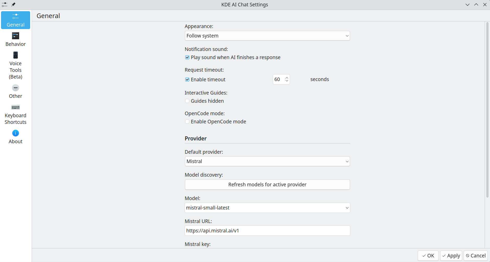
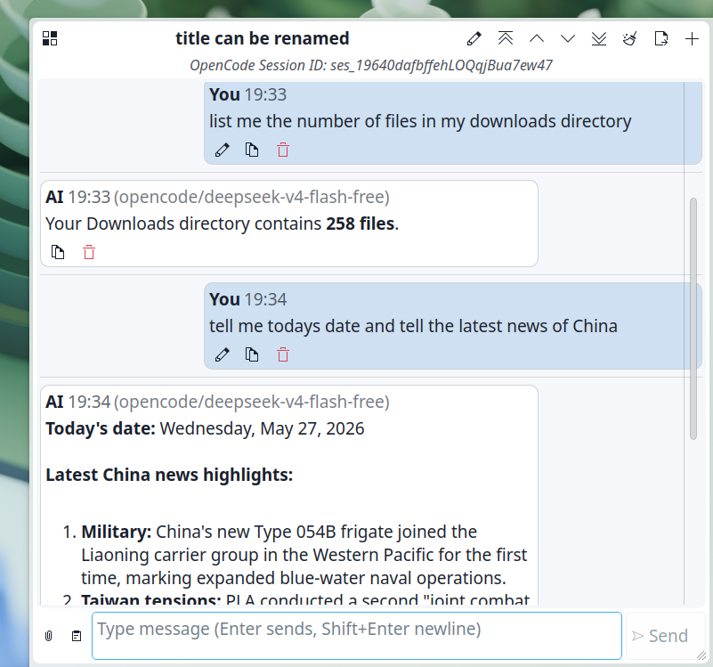
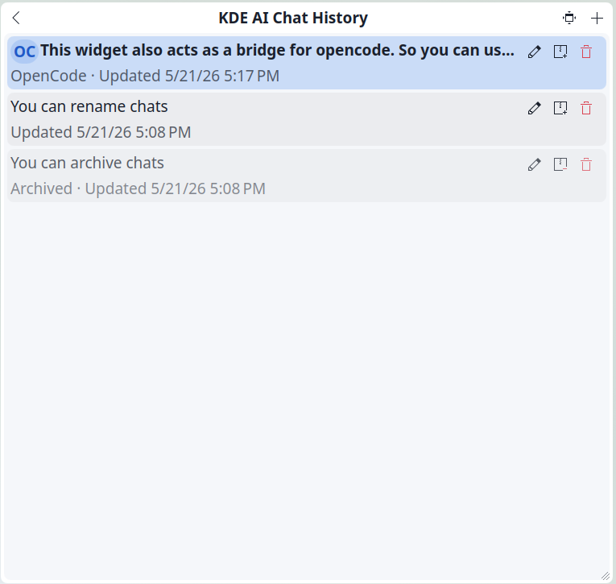
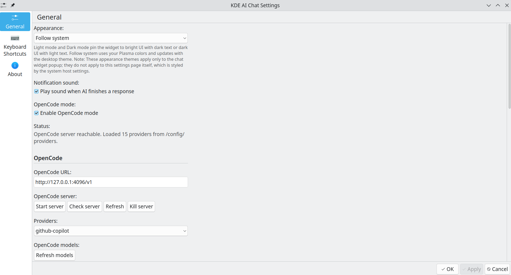
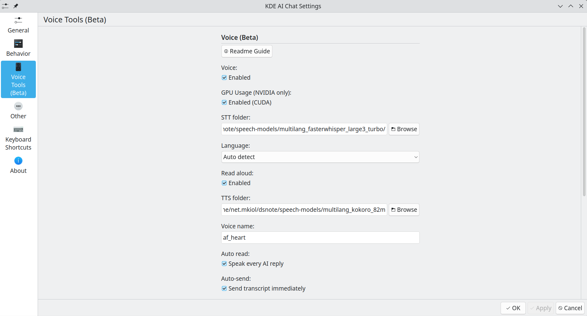
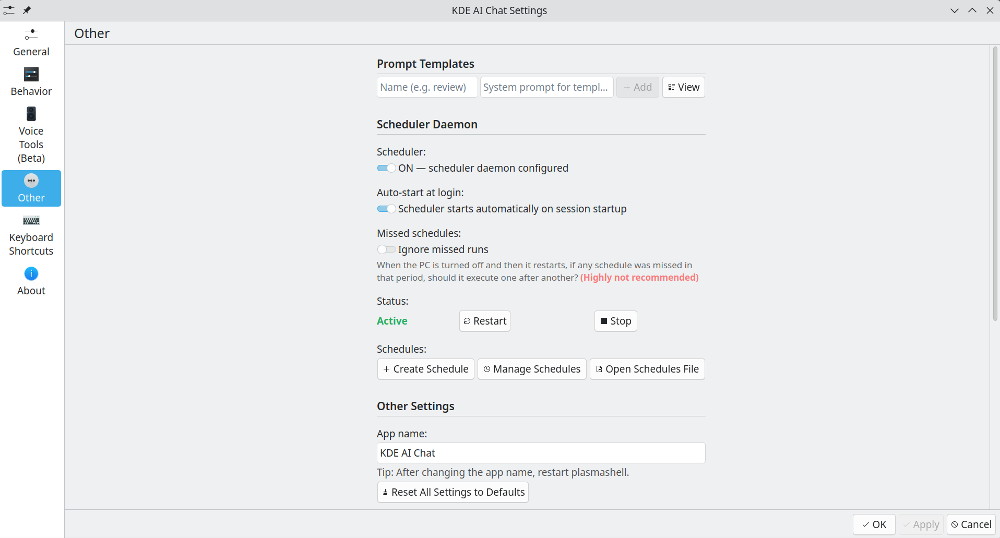
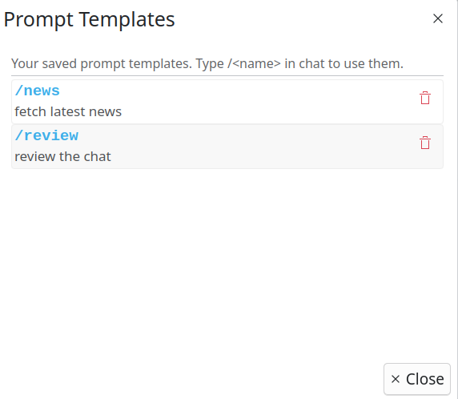
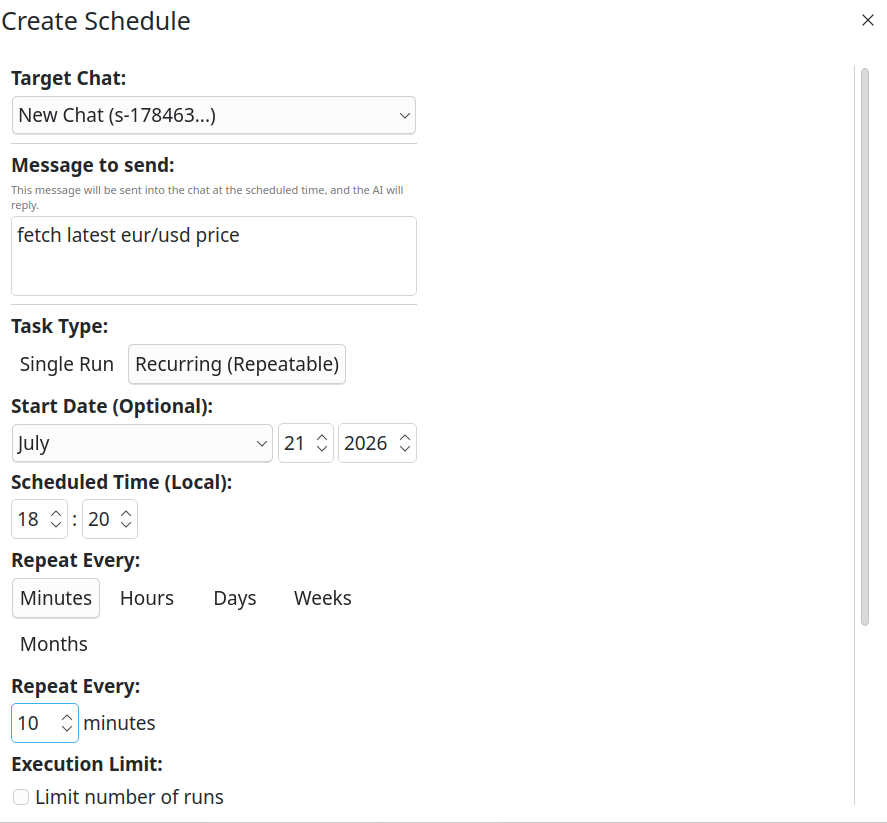

# KDE AI Chat — Native KDE Plasma 6 AI Chat Widget

[](https://store.kde.org/p/2360152/) [](https://github.com/racstan/KDE-AI-Chat/releases)

A native, fast, and easy-to-use AI chat assistant widget for the **KDE Plasma 6** desktop. It connects directly to your favorite AI providers (including offline local models), lets you drag-and-drop files, schedule automated tasks, and securely save your API keys.

---

### 📸 Gallery & Features

| Screenshot | Description |
| :--- | :--- |
|  | **General Settings (API Config)**: Basic settings (Notification Sound, Timeout) and API configurations for default providers like Mistral. |
|  | **Chat & Text-Selection TTS**: Active conversation showing text selection highlight and the global status bar **"■ Reading aloud..."** with the Stop button. |
|  | **NVIDIA NIM Provider Config**: Settings showing dynamic model loading (118 models fetched) and NVIDIA NIM provider setup. |
|  | **OpenCode Local Configuration**: Developer settings panel for local API server connections (Ollama / Llama.cpp) and model selections. |
|  | **Voice Tools Setup**: Detailed setup for GPU/CUDA acceleration, local model directories (Whisper & Kokoro), and voice model configurations. |
|  | **Prompt Templates & Scheduler**: Custom prompt templates and the login-enabled Scheduler Daemon. |
|  | **Quick Prompt Templates**: View and manage short slash-command templates (like `/news`, `/review`) for instant insert. |
|  | **Task Scheduler**: Dialog allowing users to schedule periodic prompt executions (e.g. fetching stock/currency rates every 10 mins). |

---

## Key Features

- **🛡️ OpenCode Developer Bridge**: Connect the widget to your local code workspace. Run code, search the web, and execute tasks directly from your desktop panel.
- **🗣️ Local Voice Mode (STT & TTS) (Beta)**: Talk to the AI hands-free. Speaks out loud using local voice tools (configured via Python). CPU mode works broadly, with optional NVIDIA CUDA acceleration (AMD/Intel GPU acceleration is not currently configured). You can even highlight/select specific text in the chat and click the "Read Aloud" button to only read that selected part!
- **📎 Drag & Drop Files**: Paste or drag images, PDFs, CSVs, Word documents, and text files directly into the chat. You can even send a file without typing any text.
- **📝 Prompt Templates**: Save prompts you use often in the settings. Type `/<name>` in the chat to insert them instantly.
- **📅 Task Scheduler**: Set up recurring tasks (like automated code checks or periodic reminders) using simple calendar schedules or cron expressions.
- **🌳 Edit Messages & Rewind**: Edit any older question to clear the messages after it and restart the conversation from that point.
- **🔑 Secure API Key Storage**: Safely save your keys. Keys are kept only in KDE's secure password manager (KWallet), never in a config file, and chats are stored in private files on your computer.
- **🔄 15+ AI Providers**: Works with OpenAI, Claude, Groq, DeepSeek, Gemini, OpenRouter, Mistral, Ollama, LM Studio, LiteLLM Proxy, and more.
- **📤 Export Chats**: Save your chat history as Markdown (`.md`) or plain text (`.txt`) with a single click.
- **🧭 Quick Navigation**: Easily jump between your questions in a long chat using the Up and Down arrow buttons.
- **⚡ Smooth Scrolling**: Enhanced layout scrolling that won't jump or jitter as messages load.
- **❓ The AI Can Ask You**: In any mode the model or agent can ask you a question in the chat (tap an answer or type one); direct chats do this with a tool call (switch it off in Settings → Chat).
- **🔔 "Input Needed" Notifications**: With the popup closed, a question or permission request from the AI shows up as a desktop notification you can answer right there (answer buttons, a reply box, or Allow/Deny), or open the chat from it.
- **🎨 Resizable Widget**: Drag the bottom-right corner of the chat popup to resize it exactly how you want.

> [!TIP]
> **Can't find your AI provider listed?**
> You can open the `opencode` CLI in your terminal and configure/save your custom provider inside it (see the [OpenCode Providers Documentation](https://opencode.ai/docs/providers/) for details). Using the widget in **OpenCode mode** is highly recommended for everyone, as it serves as a powerful local agent bridge that supports customized endpoints, workspace commands, and custom providers.

---

## What's New in Recent Releases (v1.4.0)

- **🔀 Per-Chat Model Switching**: Change provider, model or mode for the current chat from the chat settings panel, without affecting other chats.
- **🔌 Multiple Custom Providers**: Add any number of OpenAI-compatible providers, each with its own name, URL and key — including several of the same type.
- **🚫 Disable Streaming**: For providers that reject streamed requests.
- **🖼️ Custom Widget Icon**: Use any KDE icon name or an image file.
- **🖱️ Smoother Touchpad Scrolling**: Pixel-precise two-finger scrolling.
- **🤖 Pi Coding Agent Bridge**: A new agent mode alongside OpenCode.
- **⚡ Lower Idle CPU Use**: No background polling when the scheduler is off, plus fixes for freezes when opening chat settings.

See [changelog.md](changelog.md) for the full list, including v1.3.x.

---

## Installation

### Option 1: Install from the Desktop (Recommended)
1. Right-click your desktop background or panel and select **Add Widgets...**
2. Click **Get New Widgets** -> **Download New Plasma Widgets...**
3. Search for **"KDE AI Chat"** and click **Install**.

### Option 2: Web Browser Download (KDE Store)
1. Go to the [KDE Store Page for KDE AI Chat](https://store.kde.org/p/2360152/).
2. Click the **Download** button to get the `.plasmoid` file.
3. Install it using the terminal:
   ```bash
   kpackagetool6 -i /path/to/downloaded-package.plasmoid
   ```

### Option 3: Install from Source (For Developers)
1. Clone the repository:
   ```bash
   git clone https://github.com/racstan/KDE-AI-Chat.git
   cd KDE-AI-Chat
   ```
2. Run the installer script:
   ```bash
   ./install.sh
   ```
3. Restart your Plasma shell to apply changes:
   ```bash
   systemctl --user restart plasma-plasmashell.service
   ```
4. Right-click your desktop/panel, select **Add Widgets...**, and add **KDE AI Chat**!

---

## System Dependencies

The widget works out of the box, but some features need basic system tools. If a tool is missing, the widget will show a helpful warning inside the chat and explain what to install:

| Feature | Tool Needed | Debian/Ubuntu | Arch Linux | Fedora |
| :--- | :--- | :--- | :--- | :--- |
| **Reading PDFs** | `pdftotext` | `sudo apt install poppler-utils` | `sudo pacman -S poppler` | `sudo dnf install poppler-utils` |
| **Reading Word Docs** | `pandoc` | `sudo apt install pandoc` | `sudo pacman -S pandoc-cli` | `sudo dnf install pandoc` |
| **Secure Key Storage** | `qdbus6` / `qdbus` | *Pre-installed* | *Pre-installed* | *Pre-installed* |

---

## Code Quality & Performance

- **Zero Errors**: Fully passes QML analysis checks (`qmllint`) with zero warnings and zero errors.
- **Fast and Lightweight**: Heavy API calls and file processing are run in the background so your desktop never freezes.
- **Secure Handling**: Safe DBus variables and config paths to prevent system exploits or shell injection issues.

---

## Documentation Guides

- [User Operations Manual](user_manual.md) — Step-by-step instructions on chat history, OpenCode, and Prompt Templates.
- [Voice Setup Guide (Beta)](VOICE_SETUP.md) — How to set up Speech-to-Text and Text-to-Speech engines locally.
- [API Keys Setup Guide](SETUP.md) — How to get API keys for each provider.

---

## License

Copyright (C) 2026 Rachit Asthana

KDE AI Chat is free software: you can redistribute it and/or modify it under the terms of the GNU General Public License as published by the Free Software Foundation, either version 3 of the License, or (at your option) any later version. It is distributed in the hope that it will be useful, but WITHOUT ANY WARRANTY; without even the implied warranty of MERCHANTABILITY or FITNESS FOR A PARTICULAR PURPOSE. See [LICENSE](LICENSE) for the full text.
