# Chats

## History

Press the history button in the header (or **Ctrl+H**) to open your chats. In a wide popup the history slides in beside the chat; in a narrow one it takes the whole view. Each chat is one row with its date. Rename, archive and delete appear when you point at a row or reach it with the keyboard. You can also right-click a row.

- **Rename**: type your own title. By default the AI names a new chat after your first message (turn this off in Settings → Chat, **Let the model name new chats**).
- **Archive**: archived chats leave the main list and live under **Archived**, where you can **Restore** or delete them.
- **Delete**: asks first (you can turn that off in Settings → Chat). **Undo** brings a deleted chat back for a few seconds.
- The history side (left or right) can be changed in Settings → Appearance.

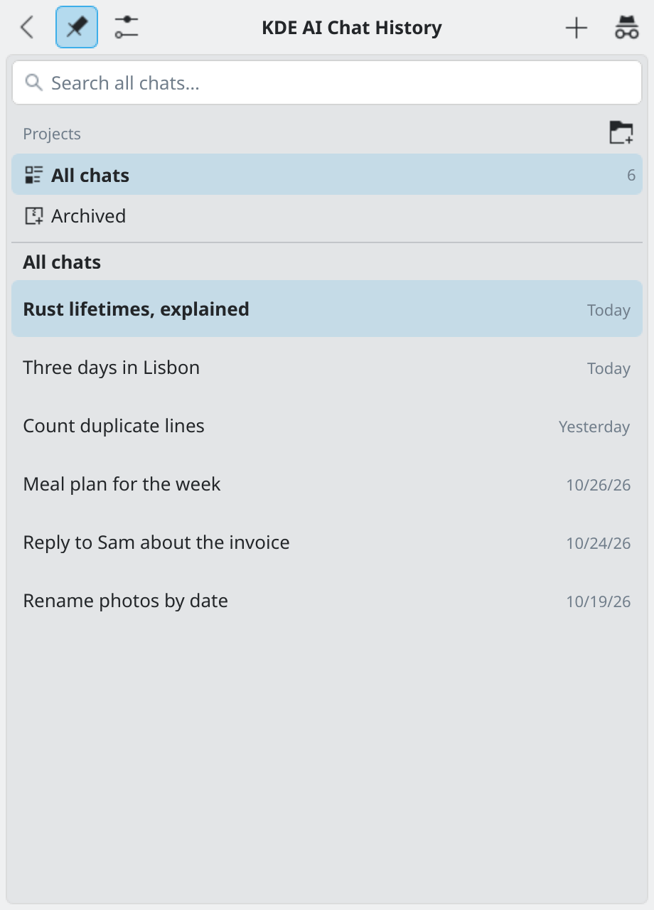
*The history beside the chat.*

## Search all chats

Type in the search field at the top of the history, or press **Ctrl+Shift+F**. It finds text in chat names and messages in every chat, including archived chats and chats in projects. A result shows the chat, the date and the text around the match. Click it (or press Enter) to open that chat at the message. Up and Down move through the results, Esc clears the field. At most 5 matches per chat and 100 in all are listed.

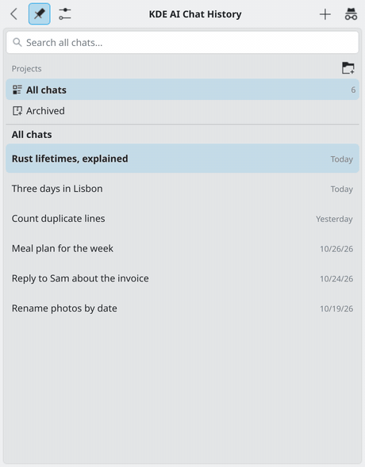
*Searching all chats.*

## Incognito chats

The button next to New chat (or **Ctrl+Shift+N**) starts a chat that is **never written to disk**. The header marks it "Incognito — not saved". It is not in the history or in search, uses no memories and adds none, no schedule can target it, and notifications do not show its name or text. It is gone when you leave it or restart the widget. Leaving one with messages asks first; Settings → Chat can turn the question off. An incognito chat works in your main mode. See also [Privacy](privacy.md).

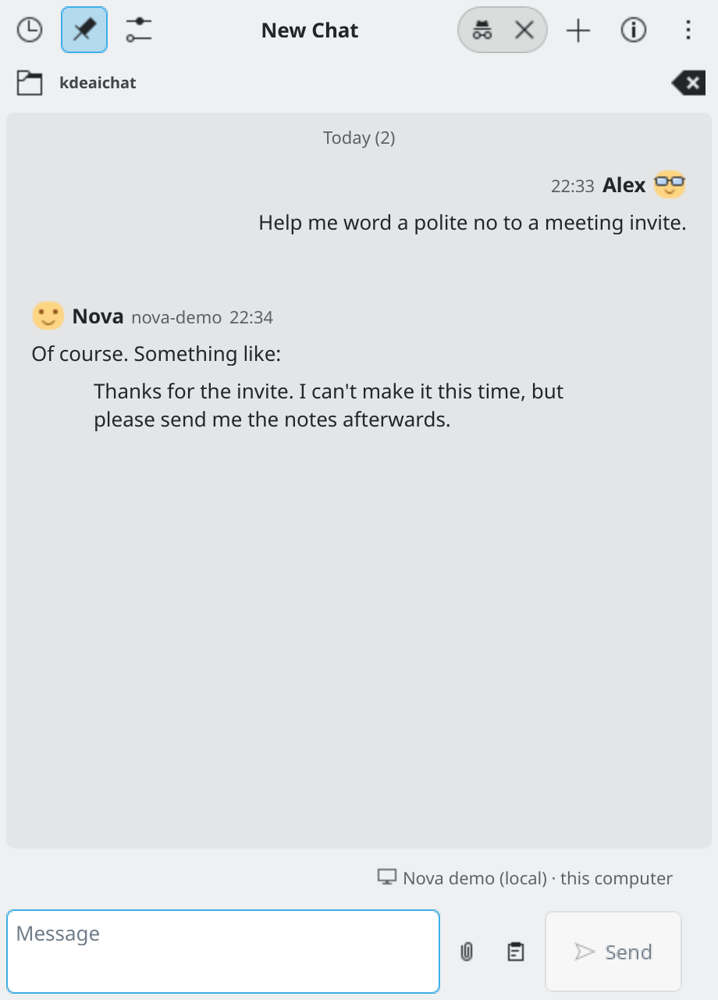
*An incognito chat.*

## Projects

A project groups chats. The history starts with **All chats**, then each project (with its colour and how many chats it has), then **Archived**. Choose one to filter the list.

- Create one with the folder button. Edit it with the pencil: name, colour, instructions, working folder and, for direct chats, a model.
- Move a chat into a project from its menu (More menu in the header, or right-click a history row), or drag the row onto the project. Start a chat in a project with the **+** next to its name.
- A project's **instructions** go to every chat in it. Its **folder** is where OpenCode and Pi work, unless the chat has its own.
- Deleting a project asks whether to keep its chats or delete them with it. **Undo** brings it back.

## Writing messages

- **Files**: drop, paste or attach images, PDFs, CSV files, Word documents and text files. You can send a file without typing text. Reading PDFs and Word documents needs `pdftotext` and `pandoc` (see the [README](../README.md#system-dependencies)).
- **Queue**: if you write while a reply is coming, your message waits and is sent after it.
- **Quote**: each message has a **Quote** button (**Ctrl+Q** for the picked message). The quote shows as a chip above the message box and goes to the AI with your message, in every mode.
- **Browse**: with the message box empty, **Up** and **Down** pick the previous and next message. Esc clears the pick. **Ctrl+E** edits your last message, **Ctrl+Shift+R** regenerates the last reply, **Ctrl+Shift+C** copies it.

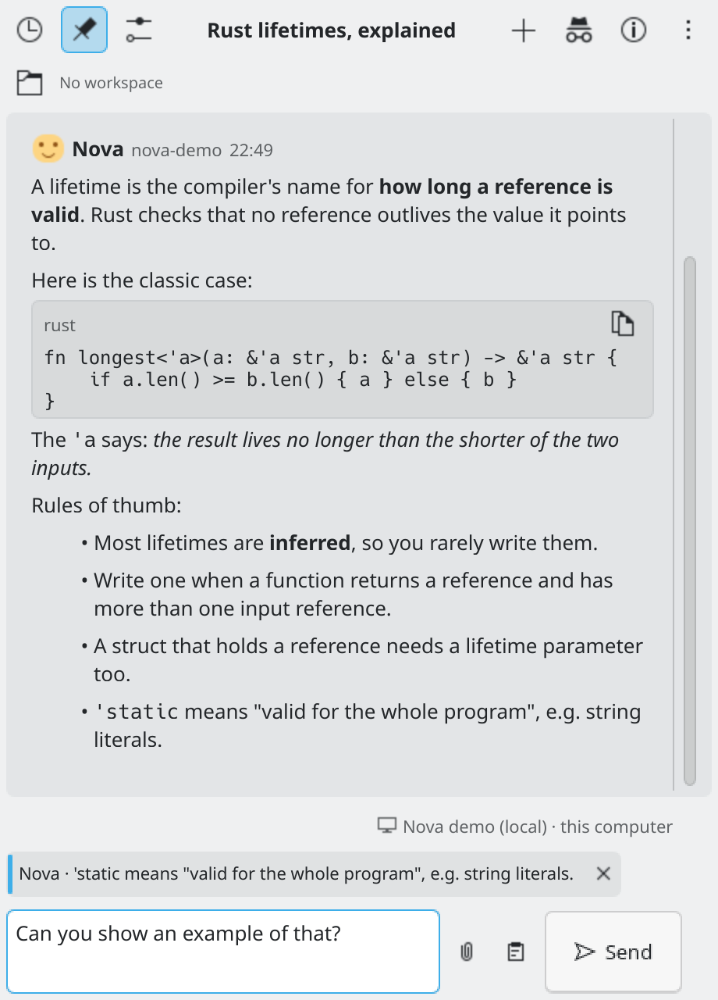
*Part of a reply quoted into the message box.*

## Edit and rewind

**Edit** an older message of yours and send it again: the messages after it are cleared and the chat continues from that point. This is the "rewind". **Regenerate** asks for a new answer to a message. A chat's messages can also be cleared from the More menu.

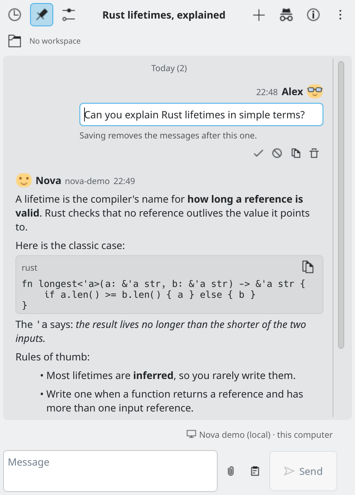
*Editing an earlier question.*

## Variants

When the model has thinking levels, a **variant** picker appears next to it. Change it with `/variant`. See [Modes](modes.md).

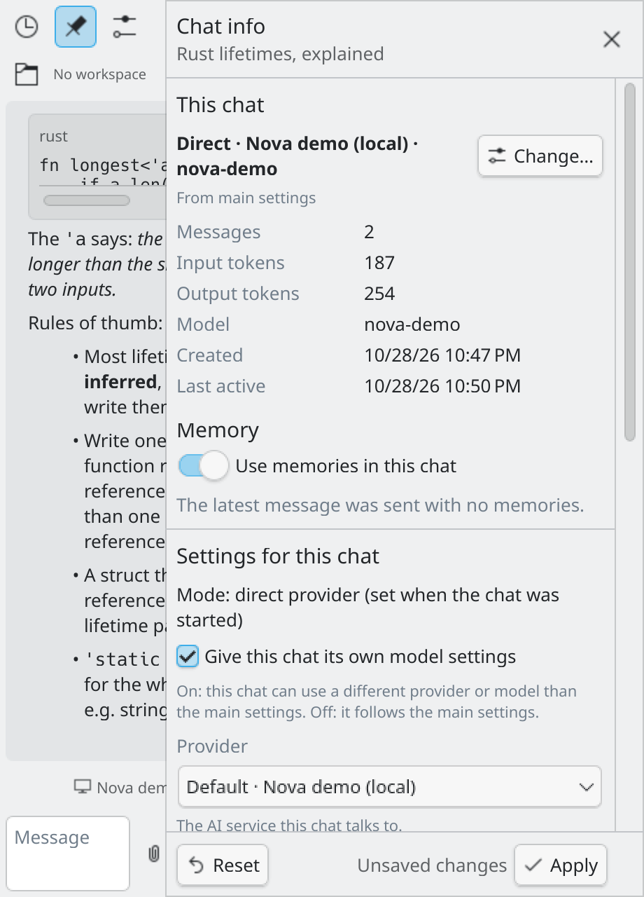
*This chat's own model settings in Chat info.*

## Slash commands

Type `/` in the message box to see the list. Up and Down move, Tab completes, Enter runs. Commands are never sent to the AI.

| Command | What it does |
| :--- | :--- |
| `/model [name]` | Change this chat's model. Without a name it opens the model picker. |
| `/variant [name]` | Change the thinking level (only listed when the model has variants). |
| `/new` | Start a new chat. |
| `/mode <direct\|opencode\|pi>` | Set the mode for **new** chats only. The open chat keeps its mode. |
| `/image <prompt>` | Make a picture with your default image service (see [Pictures](pictures.md)). |
| `/remember <text>` | Save a memory for every chat (see [Memory and personality](memory-and-personality.md)). |

`/model` and `/variant` work when per-chat model settings are on in Settings → Chat; when they are off, the command says how to turn them on. Your **prompt templates** are listed after the commands: a template is a message you use often, saved under a short name in Settings → Chat. Type `/name` to use it. Text that starts with `/` but is no command or template (like `/etc/hosts?`) is sent as a normal message.

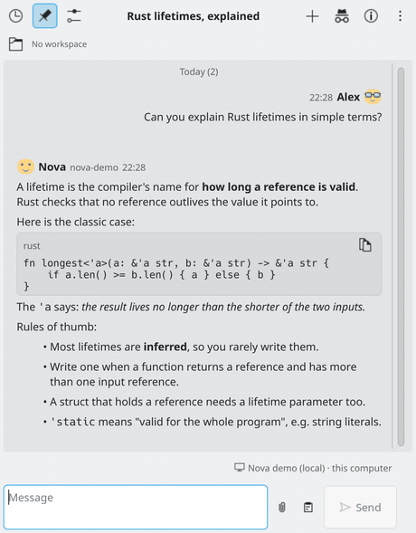
*Typing `/` lists the commands and your templates.*

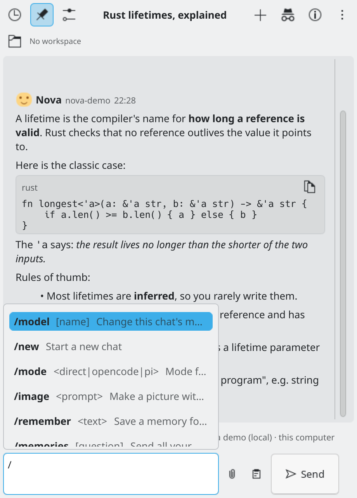
*The commands list after typing /.*

## Starting points

An empty chat shows up to six chips: your templates first (at most three), a **Continue: ...** chip that opens your most recent other chat, and built-in suggestions that change from time to time.

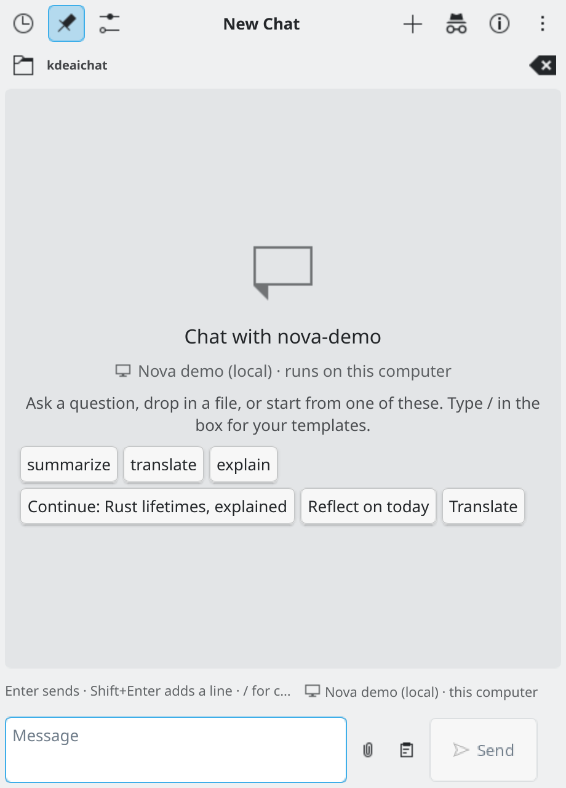
*Starting points in a new chat.*

## Chat info

The (i) button (or **Ctrl+I**) shows this chat's mode, provider and model, tokens used, the cost where the provider reports it, the number of messages, the models used, and when it was created. It also lists the memories used, and has the chat's own settings: its instructions and the length of its answers.

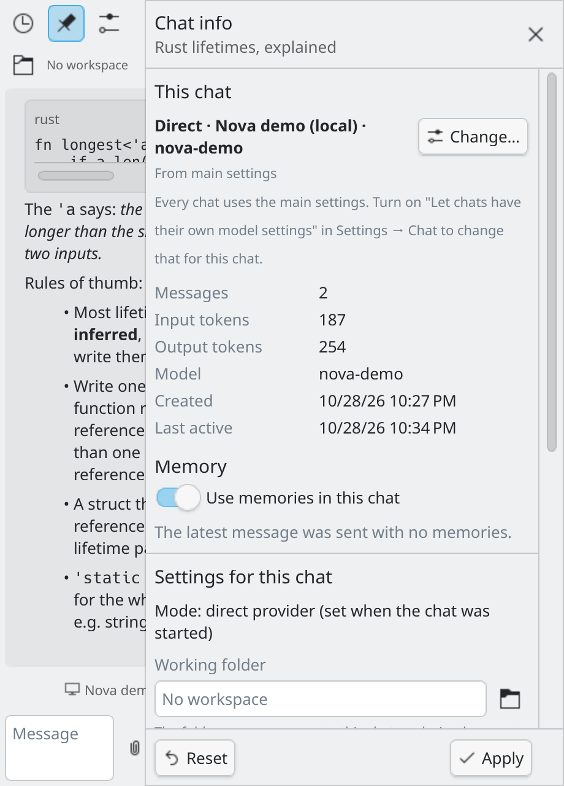
*Chat info: what the chat uses, its memory and its own settings.*

## Export

Choose **Export chat...** from the More menu. Pick Markdown, plain text or JSON in the save dialog. The file starts with the chat title and details, has clear speaker headings with times, keeps code in fenced blocks, and lists attachments and tool calls. The AI's internal reasoning is left out.

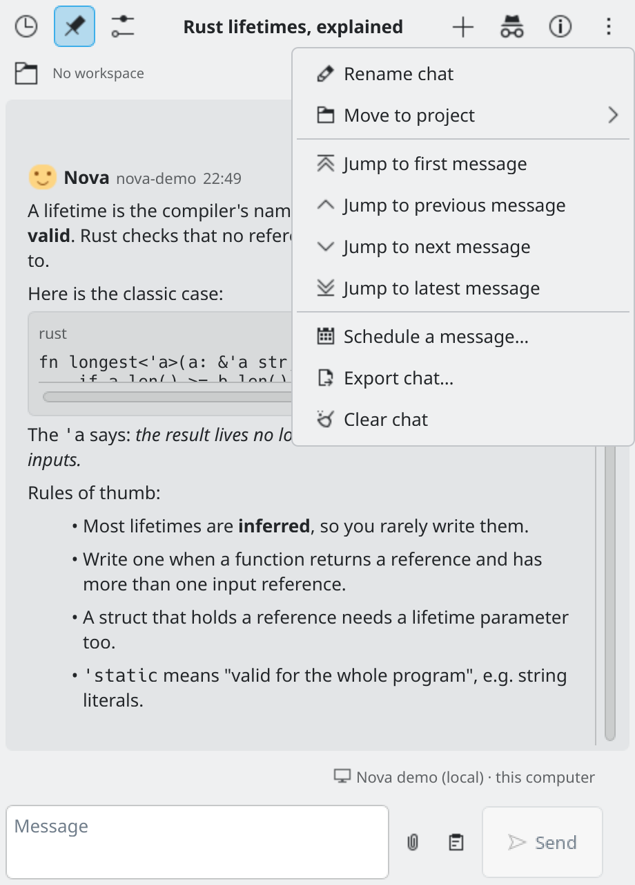
*The ⋮ menu: rename, move to a project, jump between messages, schedule, export, clear.*

## When a chat file is damaged

A chat file that cannot be read is shown empty with a notice. The widget keeps a copy named `chat-<id>.ini.damaged-<date>` and never overwrites the file, so you can repair it by hand. If the chat list itself is damaged, the widget restores it from its backup and tells you once. If that fails too, saving stops, a copy is kept, and **Rebuild the chat list from chat files** lists your chat files again.

A reply that is still being written is saved every 20 seconds. If the widget stops meanwhile, the chat opens with what had arrived, marked "(interrupted)".

## Keyboard shortcuts

The full list is in Settings → Appearance → **Keyboard shortcuts**. Most cannot be changed yet (see the README's Known Problems).
