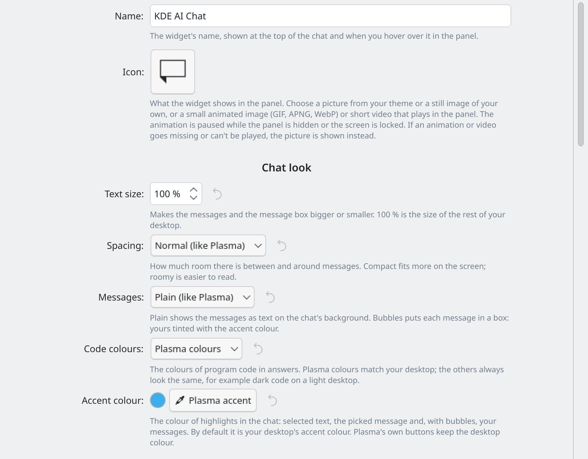
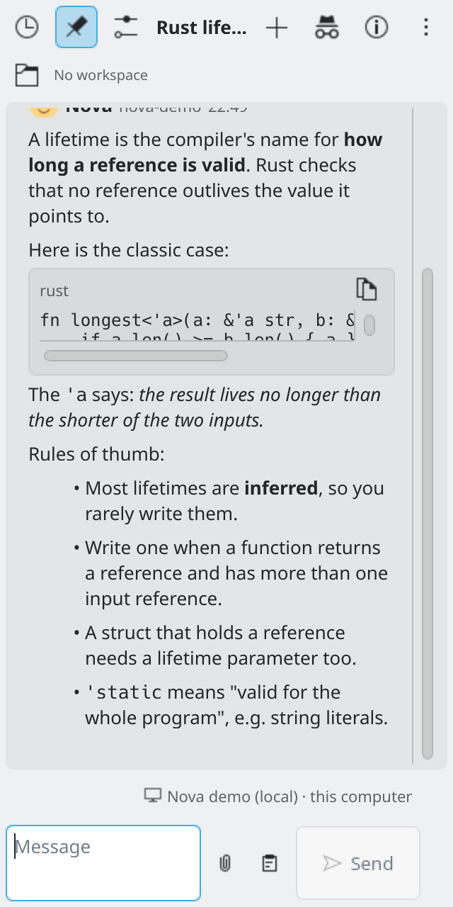
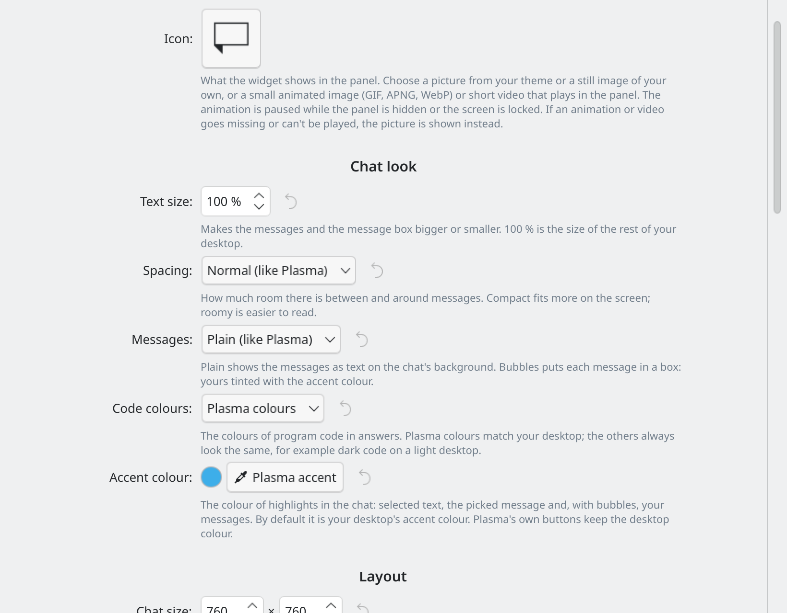
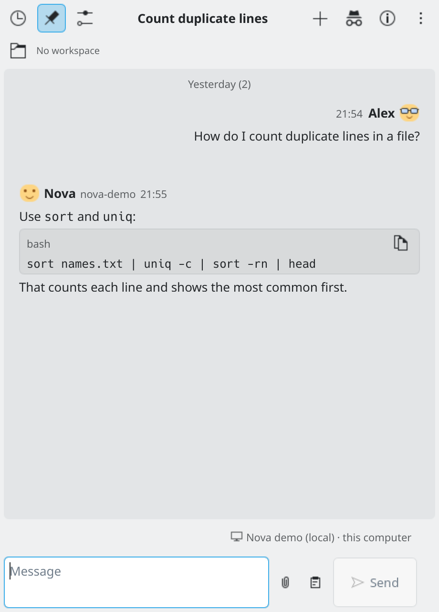

# Customising

By default the widget follows your Plasma theme, light or dark, and your accent colour. Every option on this page is optional and off or at its normal value until you change it. Open them in **Settings → Appearance** (right-click the widget and choose **Configure KDE AI Chat...**).

*Settings → Appearance.*

## Chat look

- **Text size**: makes the messages and the message box bigger or smaller. 100 % matches the rest of your desktop.
- **Spacing**: Compact, Normal or Roomy.
- **Message style**: Plain (text on the chat's background, like Plasma) or Bubbles (each message in a box; yours tinted with the accent colour).
- **Code colours**: Plasma colours, Light, Dark, Solarized light, Solarized dark or High contrast.
- **Accent colour**: the colour of highlights in the chat. By default it is your desktop's accent colour.

## Layout

- **Chat size**: the width and height the chat opens at, in pixels. Dragging the grip in the chat's bottom corner changes this too, so you can **resize** the chat by dragging. The grip sits in the corner that grows away from the panel.
- **History side**: left or right.
- **Folder bar**: show or hide the folder and project bar above the chat. OpenCode chats always show it, for the agent choice.
- **Buttons at the top**: hide the buttons you don't use (history, pin, settings, new chat, info). The keyboard shortcuts still work, and the More button always stays.

*A narrow popup: Send and ⋮ stay visible.*

## Behaviour

These are in **Settings → Chat**:

- **Send key**: Enter sends (Shift+Enter adds a line), or Ctrl+Enter sends (Enter adds a line).
- **Follow the answer while it is being written**: turn off to read at your own pace; a "New messages" button takes you to the end.
- **Time format**: 24-hour, 12-hour or like your region.
- **Ask before deleting a chat**, and **Start a new chat each time the widget opens**.

## Widget name, sound and notifications

The name shows at the top of the chat and when you hover over the widget. You can play a short sound when a reply is finished. **Notifications** lets you choose when you hear from the widget: a reply finishes while the chat is closed, a request fails, a scheduled task runs, or the AI needs an answer or permission.

## Icon

**Icon** is one setting with a menu: a picture from your theme, a still image of your own (PNG, JPEG, WebP, GIF, SVG or BMP), an **animated image** (GIF, APNG or WebP) or a **short video** (MP4, WebM, MKV, MOV, M4V or OGV). Videos are silent and repeat, and are offered only when Qt Multimedia is installed. A file over 20 MB is refused, and one over 5 MB gets a warning (big animations use more memory and power). The animation pauses while the panel is hidden or the screen is locked. **Animate only while the pointer is on it** keeps the panel calm. A missing or unplayable file falls back to the normal icon. **Reset to Default Icon** puts it back.

*The widget's icon setting.*

## Avatars

In **Settings → Personality** you can give the AI and yourself an avatar: an icon from your theme, an image, an animated image or a short video, with the same limits as the panel icon. The chat shows your name and the AI's name above the messages, once for each run of messages from the same sender.

*Your avatar and the AI's next to the messages.*

## Keyboard shortcuts

The list of shortcuts is in Settings → Appearance → **Keyboard shortcuts**. Only the shortcut that opens the widget can be changed (in Plasma's widget settings). The others are fixed for now.
