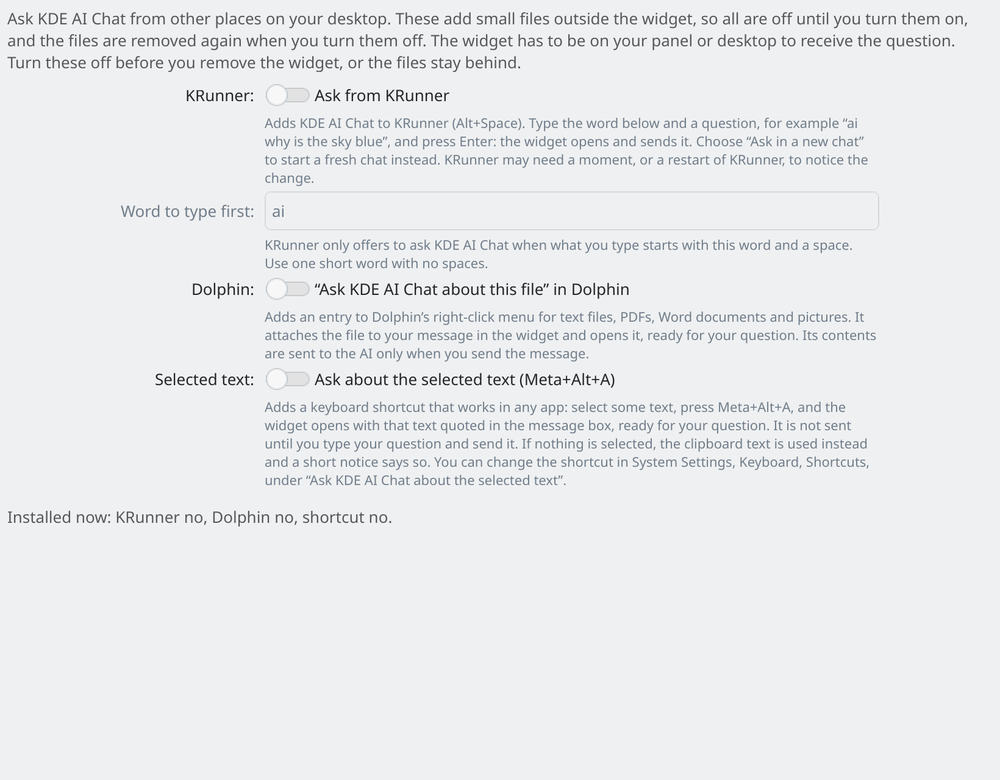

# Desktop integration

You can ask KDE AI Chat from other parts of your desktop. **Settings → Desktop integration** has three switches. All are **off** until you turn them on. They add small files outside the widget and remove them again when you switch them off. The widget has to be on your panel or desktop.

*Settings → Desktop integration.*

## KRunner

Press **Alt+Space**, type `ai` and a question, for example `ai why is the sky blue`, and press Enter. The widget opens and sends the question to the chat you had open, in that chat's own mode. Choose **Ask in a new chat** to start a new chat in your default mode instead.

The word `ai` can be changed (**Word to type first**: one short word, no spaces). If KRunner does not offer it at once, restart KRunner with `kquitapp6 krunner`.

## Dolphin

Right-click a text file, Markdown, CSV, JSON, PDF, Word document or picture and choose **Ask KDE AI Chat about this file**. The file is attached to your message and the widget opens with the message box ready. **Nothing is sent until you press Send.** Select more than 10 files and the first 10 are attached, with a notification saying so.

## Selected text

Select text in any app and press **Meta+Alt+A**. The widget opens with the text quoted (lines starting with ">") in the message box. Type your question below it and send. **Nothing is sent by itself.** If nothing is selected, the clipboard text is quoted instead and a short notice says so.

Change or remove the shortcut in System Settings → Keyboard → Shortcuts, under "Ask KDE AI Chat about the selected text" (use "Add Application" there if it is not listed).

## Safety rules for the ask inbox

Other programs hand a question to the widget through a private "ask inbox": one private file per request in your runtime folder, which is gone at logout. So a question never sits on a command line that other users could read. The rules:

- A request that has **files** never sends by itself. The files are attached, the question is put in the message box, and you press Enter. (A KRunner question without files sends at once.)
- Files must be real, readable files under your **home folder**.
- Anything inside a **hidden folder or a hidden file** (such as `.ssh` or `.gnupg`) is refused. Each refused file is named in the chat.
- A request goes into the open chat in that chat's own mode. It never changes a chat's mode.
- Requests older than a day are dropped.

## Command line

`kdeaichat-ask [--new-chat] [--send] [--file PATH] "question"` (or `kdeaichat-ask --selection`). It is in the widget's `contents/ui/scripts/` folder. Use `--stdin` to pass a private question without putting it on the command line.

## Before you remove the widget

Turn the three switches off first. Their files live outside the widget, so removing the widget does not remove them.

## Notifications

The widget shows desktop notifications (**Settings → Appearance → Notifications**) when a reply finishes while the chat is closed, a request fails, a scheduled task runs, or the AI needs an answer or permission ("input needed"). Each one has an **Open chat** button that opens the popup on that chat. A finished reply also has **Read aloud** while read aloud is on. For "input needed", you can often answer right in the notification (answer buttons, a reply box, or Allow and Deny). Incognito chats show no name or text in notifications.
