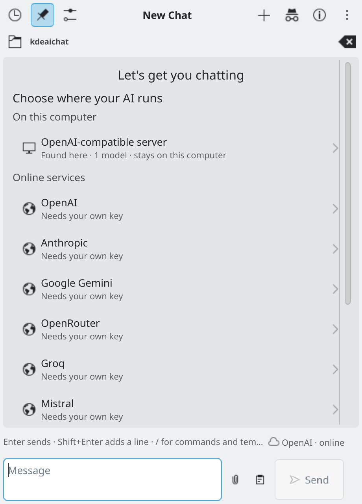
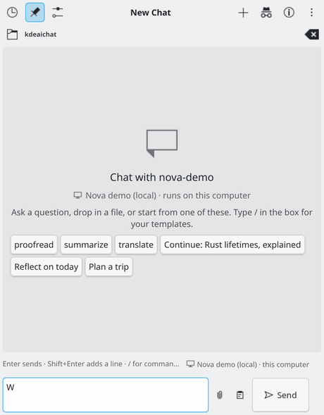
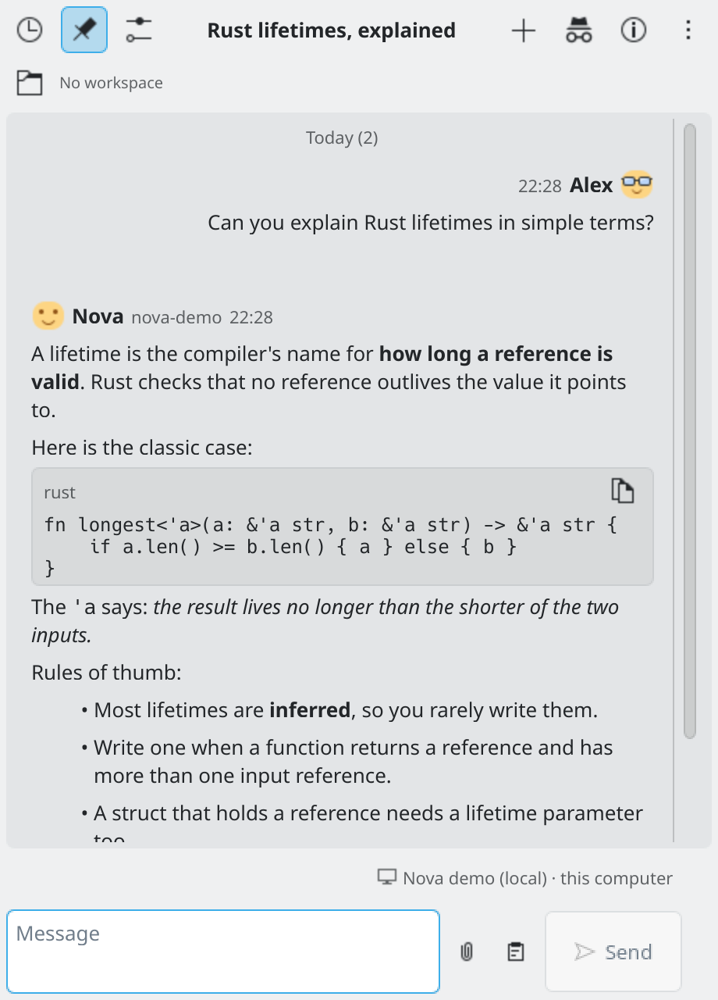

# Getting started

This page takes you from a fresh install to your first answer.

## 1. Add the widget

Install KDE AI Chat (see the [README](../README.md#installation)). Then right-click your desktop or a panel, choose **Add Widgets...** and drag **KDE AI Chat** onto it. On a panel it shows as an icon that opens the chat. On the desktop it is a small chat window.

## 2. Choose where your AI runs

The first time you open the chat, you see a short setup card instead of an empty chat, with the title **Choose where your AI runs**. It lists:

- the AI programs it finds on your own computer, such as Ollama or LM Studio (no key needed);
- well-known online services, with a link to the page where you make a key.

Pick one. For an online service, paste your key (the **Get a key** link opens the service's key page) and press **Check key**. The widget asks the service before it keeps the key. Then pick a model and press **Save and continue**. A last screen offers **Send a test message** or **Start chatting**. If you would rather do this later, press **Skip — I'll set it up in Settings**. You can always open the settings later: right-click the widget and choose **Configure KDE AI Chat...**, then the **Connection** page. More in [Providers](providers.md).

*An empty chat. The chips are starting points; type `/` to see commands and your templates.*

*The first-run card: choose where your AI runs.*

## 3. Say hello

Type in the message box and press Enter. (If you prefer, change this to Ctrl+Enter in Settings → Chat → Behaviour.) The answer appears as it is written. While it is coming, the Send button becomes **Stop**. If you write another message meanwhile, it is queued and sent after the current reply finishes.

You can also:

- **drop or paste files** into the chat: images, PDFs, CSV files, Word documents and text files;
- type `/` to see commands such as `/model` and `/image`, and your own templates;
- look at the small badge in the status line by the message box. It says where your messages go, for example "OpenRouter · online" or "Ollama · this computer". Hover over it for the full sentence.

*Sending a message and watching the answer appear.*

*A conversation, with names and avatars.*

## 4. Check that things work

If something does not work, open **Settings → Connection** and press **Check setup**. It looks at what your settings need on this computer and says how to fix what is missing. It changes nothing by itself. A failed message also shows a **Check setup** button right under the error.

## Where to go next

- Add more providers or find local servers: [Providers](providers.md)
- Code with an agent: [Modes](modes.md)
- Keep your chats tidy: [Chats](chats.md)
- Let it remember you: [Memory and personality](memory-and-personality.md)
- Having trouble: [Troubleshooting](troubleshooting.md)
