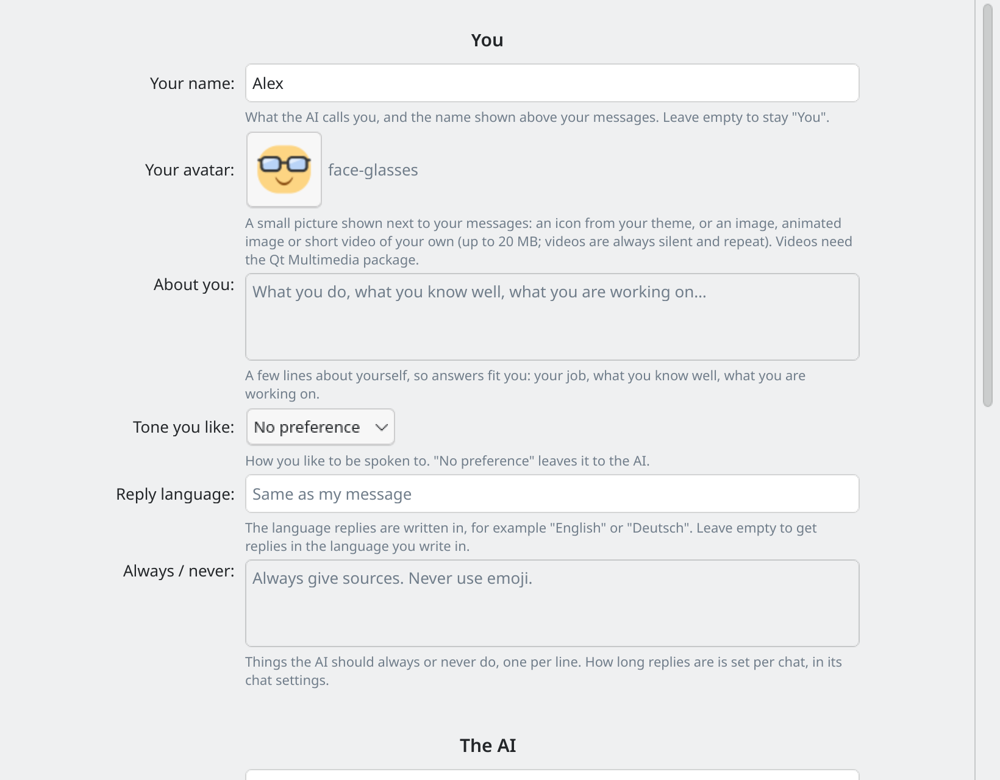
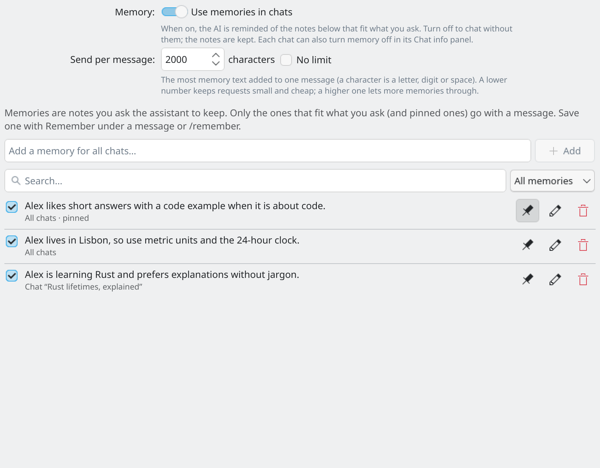
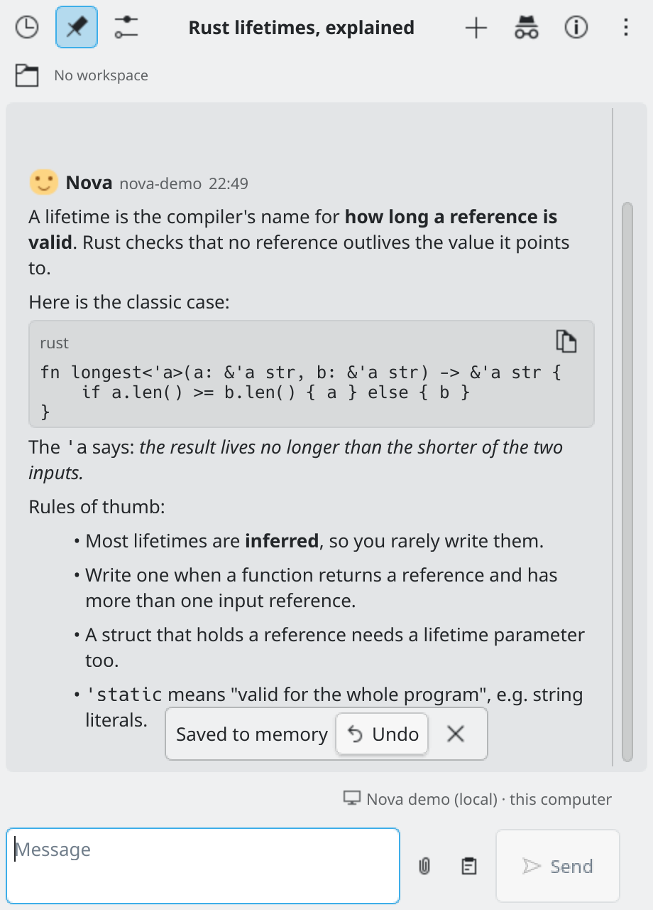

# Memory and personality

Two pages in the settings help the AI know you: **Personality** (who you are, how the AI should act) and **Memory** (short notes you ask it to keep).

## Personality

Open **Settings → Personality**.

*Settings → Personality.*

**You**
- **Your name**: what the AI calls you, and the name shown above your messages. Leave it empty to stay "You".
- **About you**: a few lines about yourself, such as your job, what you know well and what you are working on.
- **Tone you like**: Friendly, Professional, Concise or Playful, or no preference.
- **Reply language**: the language replies are written in, or "Same as my message".
- **Always / never**: things the AI should always or never do, one per line.
- **Your avatar**: a small picture next to your messages (see [Customising](customising.md)).

**The AI**
- **Its name**: shown above its replies. Leave it empty to show the name of the model instead.
- **Personality**: None, Friendly, Professional, Witty, Mentor, Concise, or **Custom** in your own words.
- **Avatar**: a small picture next to its replies.

**Extra instructions**: anything else the AI should know or do in every chat. This is sometimes called the system prompt.

What you fill in is sent at the start of every chat: Direct, OpenCode and Pi alike. Nothing is sent for fields you leave empty. A chat can turn it off with **Use my Personality settings** in its own settings.

## Memory

Memories are short notes you ask the assistant to keep. Only you save them; the AI does not add any by itself.

**Save a memory**
- Press **Remember** under a message (or select some text first). A small editor opens and asks where the note applies: all chats (the default), the chat's project, or this chat only.
- Or type `/remember your note` in the message box. It saves a note for all chats and sends nothing.

Both confirm with "Saved to memory" and an **Undo**.

**Manage memories** in **Settings → Memory**. You can search and filter the list (all chats, a project, one chat, turned off), add a note, and for each note turn it off, pin it, edit it or delete it (with Undo).

*Settings → Memory.*

**How memories are used**
- **Use memories in chats** switches memory on or off for every chat.
- With each message, the pinned notes and the notes that best fit what you ask go along, up to a size you choose in **Send per message** (2000 characters by default; a lower number keeps requests small, or choose no limit).
- In **Chat info**, a Memory section shows the notes the latest message was sent with, and **Use memories in this chat** turns memory off for just that chat.
- Memories work in all modes.
- In an [incognito chat](chats.md#incognito-chats), memories are neither used nor saved.

Memories are kept in a private file, `~/.local/share/kdeaichat/memory.json`, never in the widget's settings. Deleting a chat or project deletes its notes (Undo brings them back). See [Privacy](privacy.md).

*A memory saved from the chat, with Undo.*
