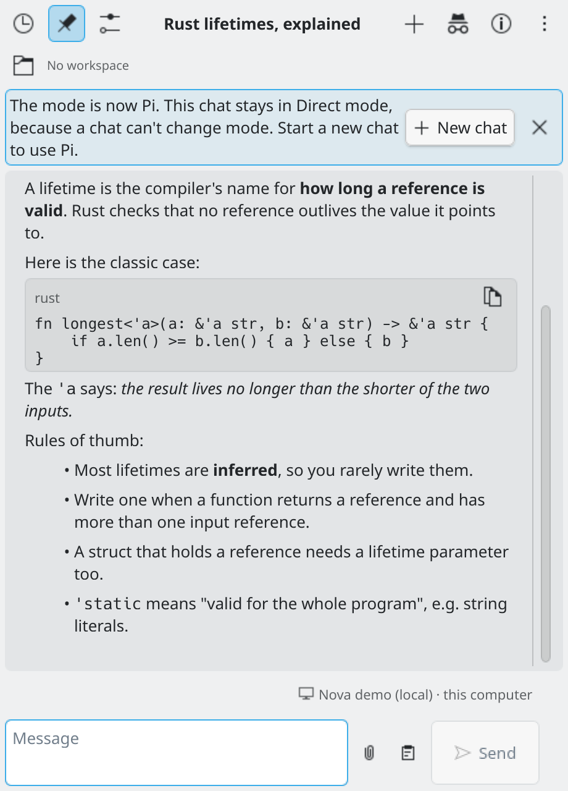
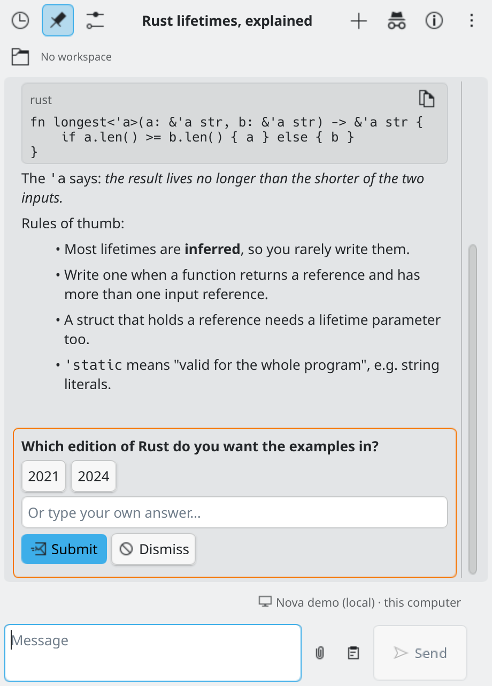
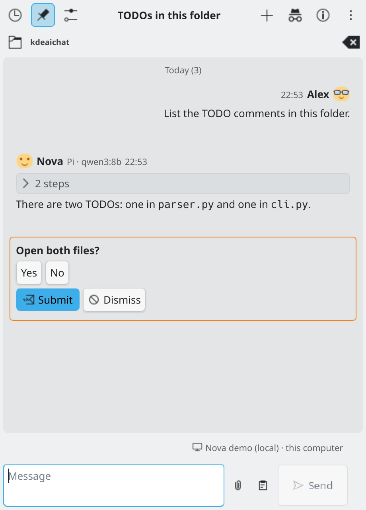
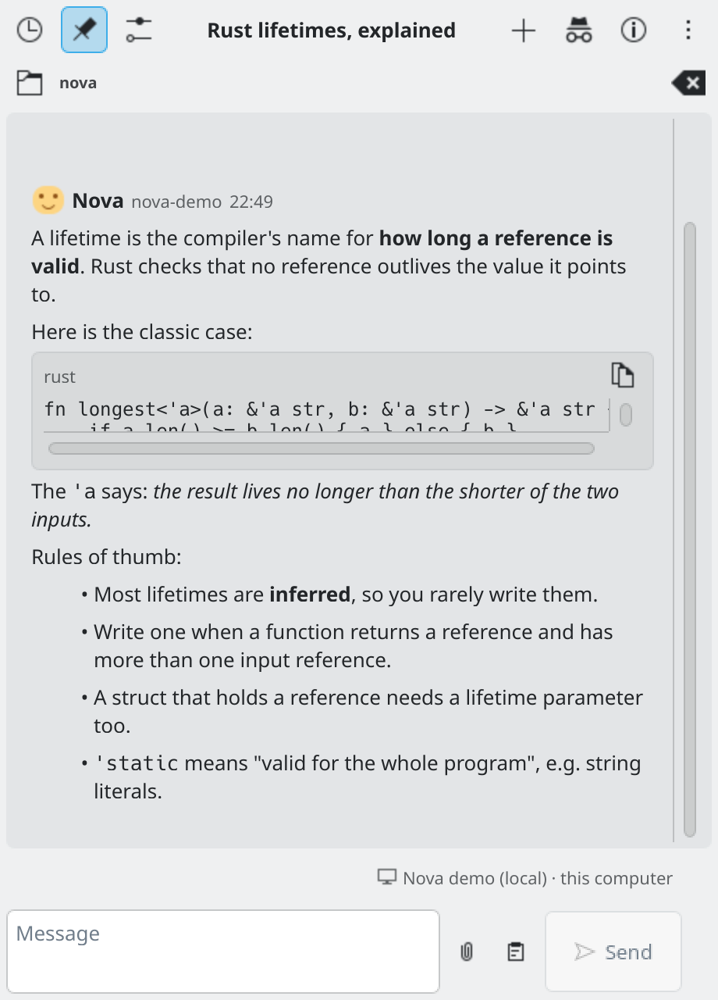
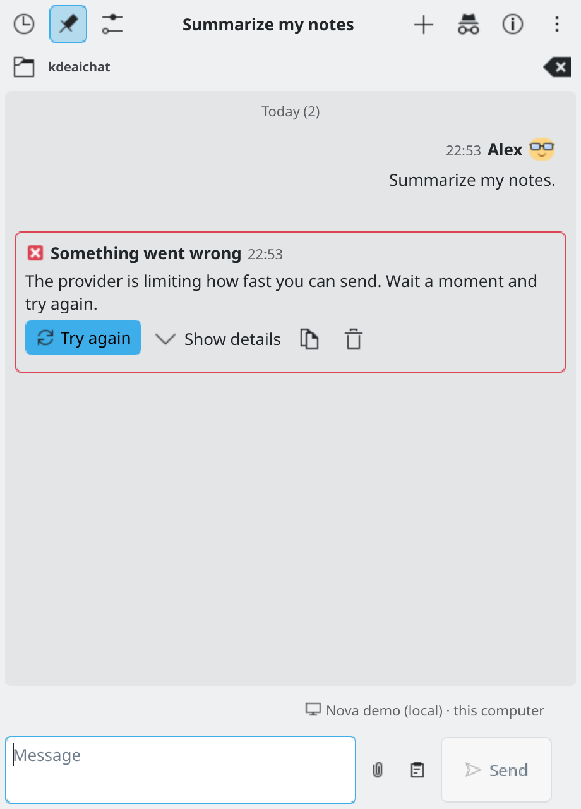

# Modes

KDE AI Chat can send your messages in three ways. You choose the way for **new chats** in **Settings → Connection**, under **Send messages**.

| Mode | What it is | Good for |
| :--- | :--- | :--- |
| **Directly to a provider** (Direct) | The widget talks to an AI service, or to a model on your computer such as Ollama. | Everyday chat. The usual choice. |
| **Through OpenCode** | [OpenCode](https://opencode.ai/), a separate coding agent, does the work. It can read and change files in the chat's folder. It has to be installed. | Coding help. |
| **Through Pi** | Like OpenCode, but with the Pi coding agent, which also has to be installed. | Coding help. |

## A chat keeps its mode

**A chat can't change mode.** A chat started in Direct mode stays Direct. A chat started in OpenCode stays OpenCode. A chat started in Pi stays Pi. This holds for every chat, including one that is still writing a reply.

Changing the mode in Settings (or with the `/mode` command) only affects **new chats**. Your open chat does not move.

If the mode in Settings is different from the open chat's mode, the chat shows a notice: "The mode is now ... This chat stays in ... mode, because a chat can't change mode. Start a new chat to use ...". The notice has a **New chat** button.

To use another mode, start a new chat. Chat info shows the mode of the open chat, marked "set when the chat was started".

*The notice when Settings uses another mode than the open chat.*

## Direct mode

You set up providers in [Providers](providers.md). The widget sends your messages and the earlier messages of the chat to the provider you chose. Direct chats can also:

- let the AI **ask you a question** in the chat and wait for your answer (switch this off in Settings → Chat → **Let the AI ask me questions**);
- show pictures that models send back, and make pictures with `/image` (see [Pictures](pictures.md)).

*The AI asks a question in the chat.*

## OpenCode mode

1. Install OpenCode (see [opencode.ai](https://opencode.ai/); for example `curl -fsSL https://opencode.ai/install | bash`) and choose **Through OpenCode** in Settings → Connection.
2. Set the **Server address** (keep the suggested one unless you started OpenCode on another port). Press **Start** to run it in the background, or **Check** to see whether it answers. **Stop** only stops a server that this widget started.
3. Choose the **Provider**, **Model** and **Variant** for new OpenCode chats. The list comes from OpenCode itself, which keeps its own keys.

The model you choose is always used, also when the chat has an agent (such as `build`) that names its own model in OpenCode's configuration. Leave the model empty to let the agent use its own.

In an OpenCode chat you can pick the agent and the folder it works in. The agent shows what it is doing in cards, and asks for permission before it changes things: you answer with **Allow**, **Always allow** or **Reject**. If the popup is closed, an "input needed" notification lets you answer from the desktop.

*OpenCode at work: thinking, steps and a permission request.*

## Pi mode

1. Install Pi (see [its project page](https://github.com/earendil-works/pi); with Node.js: `npm install -g @earendil-works/pi-coding-agent`), set it up with your provider by running `pi` once in a terminal, and choose **Through Pi** in Settings → Connection.
2. Choose the **Provider**, **Model** and **Thinking** level for new Pi chats. The list comes from Pi itself.

The widget starts a small helper that runs one Pi per chat, in the chat's own folder. It stops by itself when idle.

*A Pi chat.*

## Folders (workspaces)

Every mode can have a **workspace**: a folder on your computer. It shows under the header as "No workspace" until you choose one, and a button clears it. In Settings → Chat you can set a **Default workspace for new chats**. The agent modes read and change files in this folder. A folder in your home is shown as `~/...`.

*A chat with a workspace folder, shown under the header.*

## Attached files in each mode

- **Direct chats** have no file tools, so an attached document (PDF, Word, CSV, text) is read by the widget and its text is put into your message. When that text is very large (over about 100,000 characters) the file shows a warning icon: sending it may be slow or expensive, and the AI may not use all of it.
- **Pi and OpenCode chats** do not read the document. The message just names the file ("Attached file: /path/to/book.pdf") and the agent reads only what it needs with its own tools, so a long book does not go into every question. The file stays where it is, so it must still be there when the agent reads it.
- **Images** are sent with the message in every mode.

## Per-chat model settings

By default every chat uses the mode, provider and model from the main settings. Turn on **Settings → Chat → Let chats have their own model settings** to let each chat choose its own provider and model in its **Chat info** panel (the (i) button in the header). You also choose who wins when they differ: **This chat's settings win** or **Main settings win**. The Chat info panel always says what the chat is using and where that comes from.

The model of a chat can also be changed with `/model`, and its thinking level with `/variant`. If per-chat model settings are off, these commands tell you how to turn them on.

## Variants (thinking levels)

Some models can think longer before answering. When the selected model offers this, a **variant** picker appears next to the model. Nothing is shown when the model has none.

## Where do my messages go?

The small badge in the status line by the message box says it: "OpenRouter · online", "Ollama · this computer", "Ollama · your network", or "OpenCode agent" / "Pi agent". An agent runs on your computer but sends your messages to the model it is set up with.

## When an error is about the model

If a reply fails because of the model (it can't read images, or it is not available on your account), the error card has a **Change model** button. With per-chat model settings on, it opens the model picker for just this chat. Otherwise it opens the widget's settings.

*An error card with Try again.*
