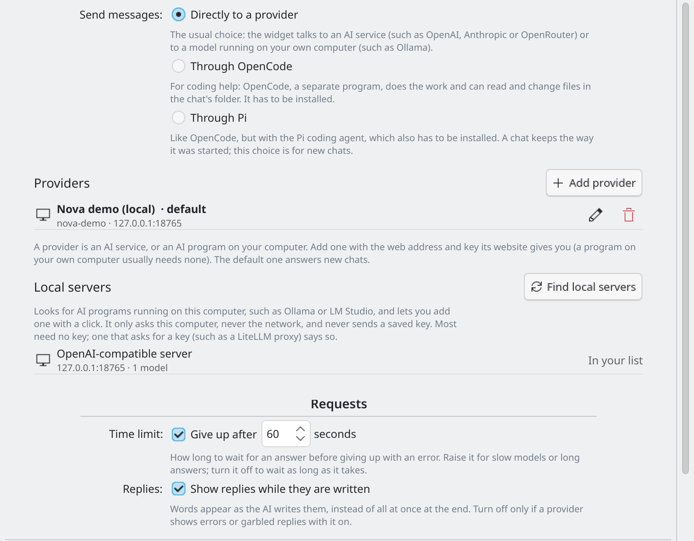

# Providers

A **provider** is an AI service on the internet, or an AI program on your own computer. You manage them in **Settings → Connection** (right-click the widget and choose **Configure KDE AI Chat...**).

*Settings → Connection: your providers, local servers and Check setup.*

## Adding a provider

1. Open **Settings → Connection** and choose **Add provider**.
2. Pick a ready-made entry. The address and the type are filled in for you. The list includes OpenAI, Anthropic, OpenRouter, Google Gemini, Groq, DeepSeek, Mistral, xAI, NVIDIA NIM, Fireworks, Hugging Face, Perplexity, MiniMax, Qwen, Moonshot, Cloudflare Workers AI, Ollama, LM Studio, llama.cpp server and LiteLLM proxy. Cloudflare's address has `YOUR_ACCOUNT_ID` in it: replace it with your own account ID.
3. Paste your **API key**. The provider's website tells you where to make one (usually under "API keys"). The first-run setup card and the key page links in [SETUP.md](../SETUP.md) help too.
4. Choose a **Model**. The list is filled in by asking the provider. Press **Refresh** to ask again. Only models you can chat with are listed; turn on **Show all models** to see the others.
5. Press **Save**.

When you save a new or changed key, the widget first checks it with the provider. If the provider rejects it, the key is not saved and the editor says so. If the provider is only busy or out of credit, the key is accepted. If the check cannot finish, you can choose **Save anyway**.

Press **Use by default** to make a provider the one that answers new chats. The default provider is listed first.

### Fields explained

- **Name**: any name you like.
- **API type**: almost every service, and local programs such as Ollama, use **OpenAI-compatible**. Choose **Anthropic** only for Anthropic's own server.
- **Server URL**: the web address from the provider's documentation, often ending in `/v1`.
- **API key**: optional for local servers.
- **Variant**: how hard a model thinks before answering, if the model offers it (see [Modes](modes.md)).

### Requests

Under **Requests** you can set a **Time limit** (seconds before a request is given up; you can turn it off) and whether **replies are shown while they are written** (streaming). Turn streaming off only if a provider shows errors or garbled text with it on.

## Local servers

Programs on your own computer, such as Ollama or LM Studio, need no key and keep your messages on your computer.

Press **Find local servers**. The widget also does a quiet check each time the page opens in direct mode. It looks only on this computer, at the usual places for Ollama (11434), LM Studio (1234), llama.cpp or LocalAI (8080), LiteLLM (4000), vLLM (8000) and Jan (1337). It just asks each one for its list of models, for about a second at most, and it never sends a key. Each server found shows its address and how many models it has. Press **Use** to add it as a provider and pick one of its models. If nothing answers, start your program and try again.

A server that asks for a key (for example a LiteLLM proxy) says so: enter the key and press Save, and the models are listed after that.

If a local server does not answer, **Check setup** says whether it is not running, too slow or at the wrong address. For Ollama, start it with `ollama serve`.

## Custom providers

Choose **Other OpenAI-compatible** and fill in a name, the server URL and, if it needs one, a key. You can add as many as you like, including several of the same kind.

Can't find your service? Another route is the OpenCode agent, which has its own list of providers (see [Modes](modes.md)).

## API keys and KWallet

Keys are kept only in **KDE Wallet (KWallet)**, in a folder called **KDEAIChat**, one entry per provider. They are never written to a settings file. Clearing a key field removes it from KWallet. If KWallet is off or locked, the widget cannot read your keys and says why in the chat. See [Privacy](privacy.md).

## Image services

AI Horde and Pollinations are picture services, not chat providers. They have their own list in the same page. See [Pictures](pictures.md).
