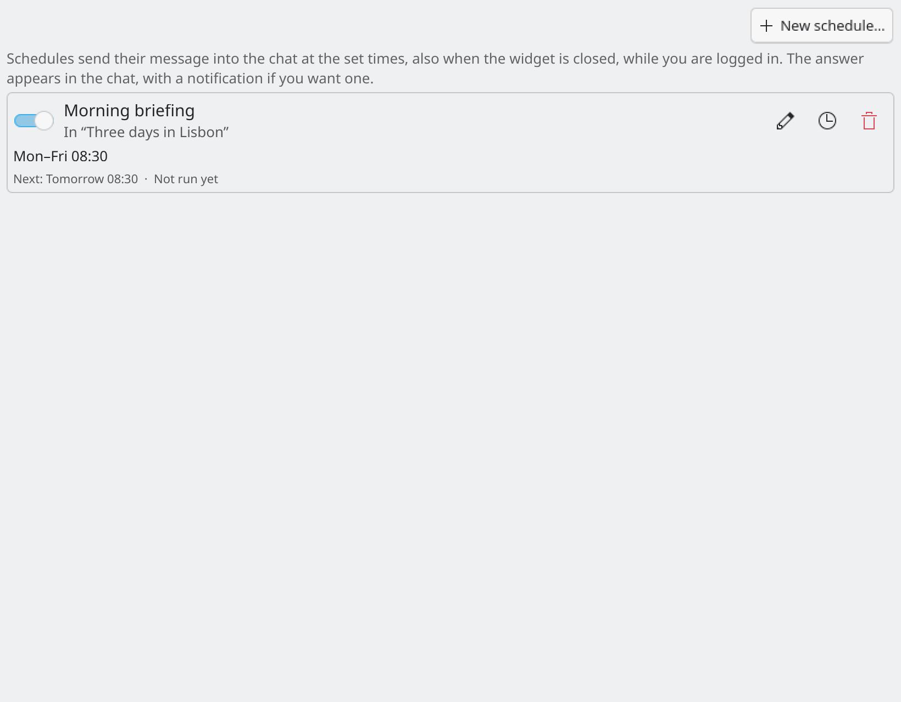
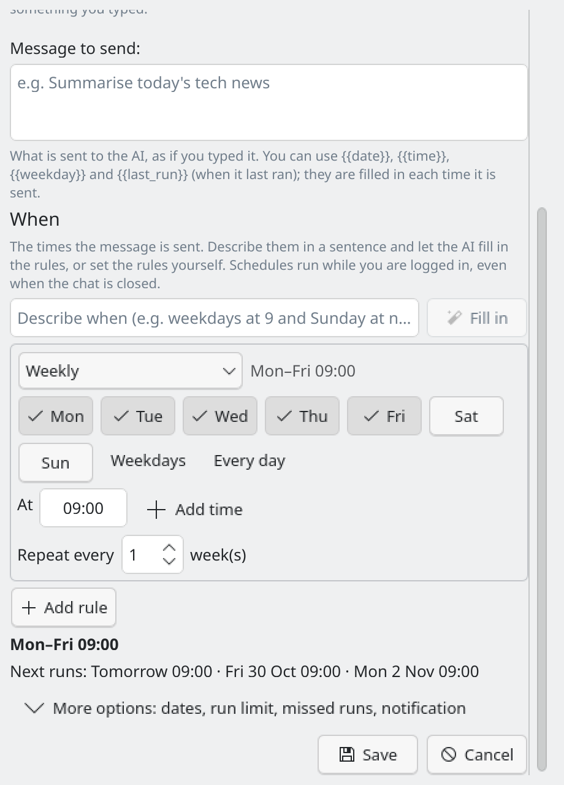
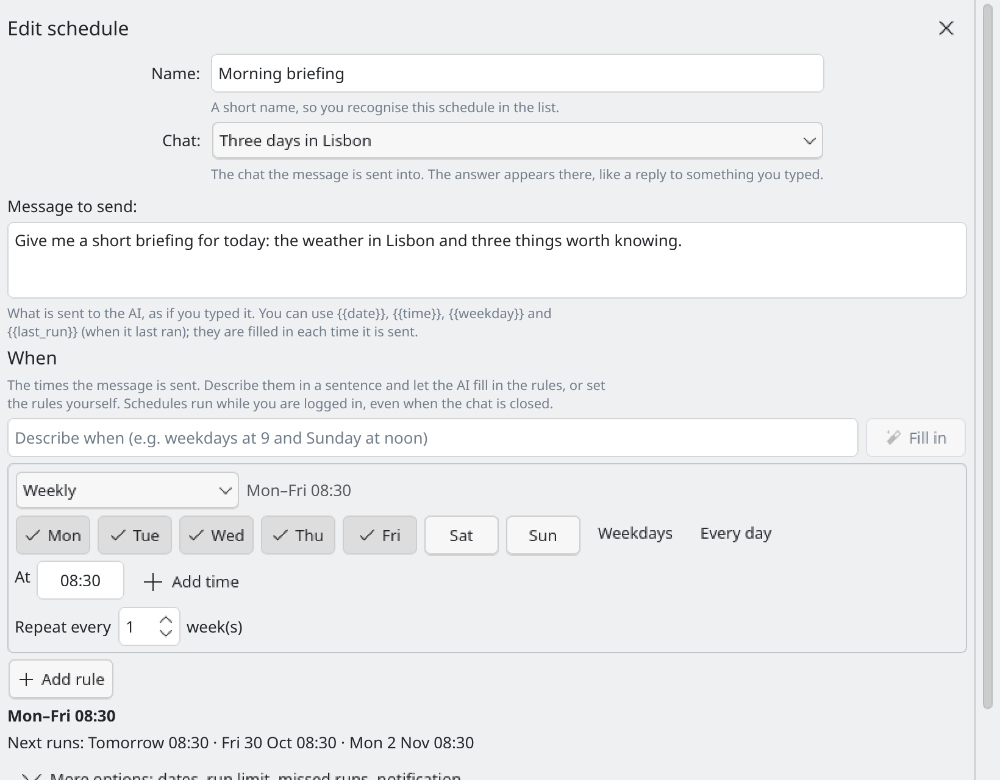
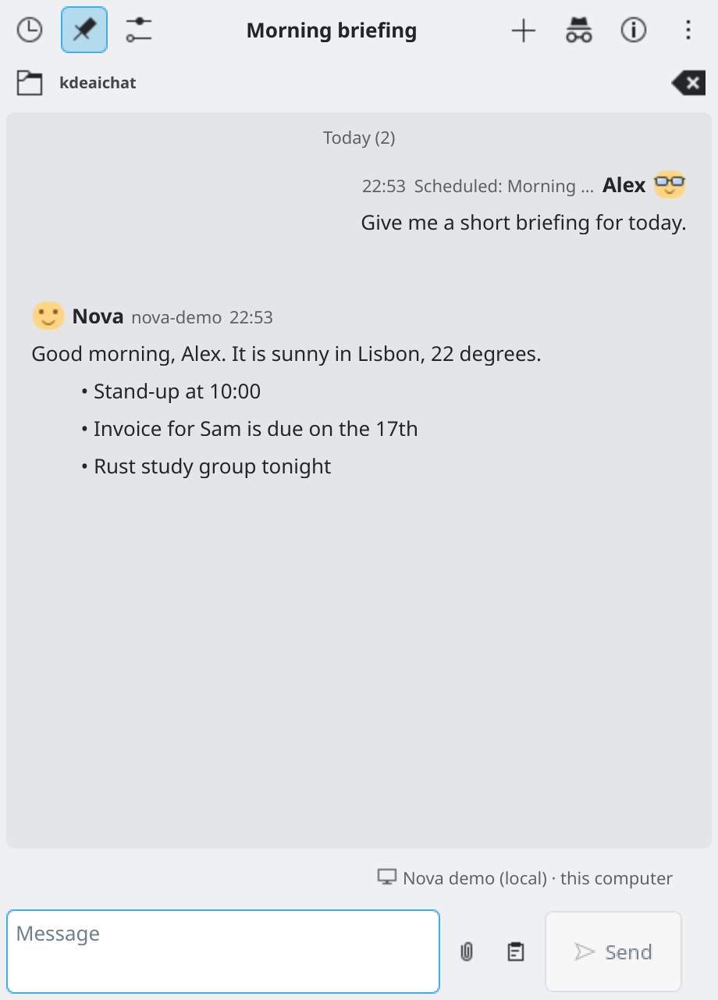

# Schedules

A schedule sends a message into a chat at set times, for example "Fetch the latest news" every weekday at 09:00. It runs while you are logged in, **even when the widget or the chat is closed**. The answer appears in the chat, with a notification if you want one.

*Settings → Schedules: each schedule has its own on/off switch.*

## Make a schedule

1. Open **Settings → Schedules** and press **New schedule...** (or choose **Schedule a message...** in a chat's More menu, which opens the same editor with that chat chosen).
2. Give it a **Name** so you recognise it in the list.
3. Choose the **Chat** the message goes into.
4. Write the **Message to send**. You can use `{{date}}`, `{{time}}`, `{{weekday}}` and `{{last_run}}` (when it last ran). They are filled in each time it is sent.
5. Set the **Times**, either way:
   - Type a sentence under **Describe when** (for example "weekdays at 9 and Sunday at noon") and press **Fill in**. Your default provider turns it into rules. If the sentence could mean two things, it asks you. Check the rules and the next runs shown below, then save. Describing needs a provider with a model in Settings → Connection.
   - Or add rules yourself with **Add rule**.
6. Save.

*The schedule editor, with a live preview of the next runs.*

## Rules

A schedule runs at the times of every rule. Each rule can be:

- weekly (pick the weekdays, every N weeks),
- every day, or every N days,
- monthly (a day of the month, or the last day of the month),
- once,
- every N hours, at a minute, optionally between two hours,
- every N minutes (at least 15),
- a custom cron line (five fields: minute hour day month weekday).

Each rule can have several times. "Mondays at 16:00 and the other days at 15:00" is two weekly rules. A preview shows what each rule means, the next three runs, and warnings (for example about daylight-saving times, months without a 31st day, or a schedule that never runs).

**More options** has a start and end date, **Stop after a number of runs**, **Run once when the computer is back** (off by default: if the computer was off or asleep, send the message once when it is back, if it was missed within a number of hours), and **Show a notification when the answer is ready**.

*Editing a schedule's rules.*

## The list

Each schedule shows its name, chat, a plain summary, the next run and the last result (sent, failed with the reason, missed). You can switch it on or off, **Edit** it, see its **History**, or **Delete** it (it asks first). A message that a schedule sent shows "Scheduled: name" next to your name.

*A scheduled message's answer in its chat.*

## How it runs in each mode

When a schedule is due, it runs without the widget, in the chat's own mode.

- **Direct chat**: the provider is called with the chat's model and instructions and its recent messages. The key is read from KWallet. If KWallet is locked, the run is skipped, recorded as "skipped: wallet locked", and a notification says so.
- **OpenCode chat**: it uses the chat's own OpenCode session and folder. If no OpenCode server answers, a temporary one is started for the run and stopped afterwards.
- **Pi chat**: it goes through the Pi helper in the chat's folder.

Memories, tools and attachments are not used in scheduled runs. Nobody can answer a permission request or a question from an agent during a scheduled run, so they are declined and the reply says so. An incognito chat can't be scheduled.

Behind the scenes each schedule is a systemd user timer; there is no background program waiting. If a timer is missing, **Check setup** offers **Recreate timers**.

Schedules from older versions are brought over automatically. Ones that lack a chat or a time say "Needs a chat and a time"; open them to finish.
