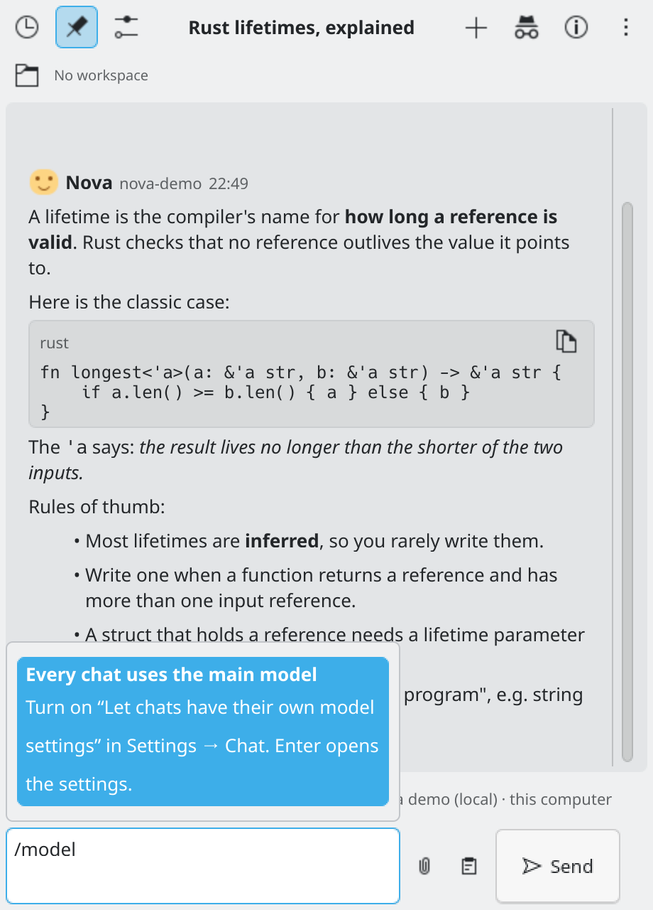

# Troubleshooting

## Start with Check setup

Open **Settings → Connection** and press **Check setup**. It looks at what your settings need on this computer and says how to fix what is missing. It **changes nothing**. It checks, among other things:

- KWallet (off or locked), providers without a key, a wrong address, a missing model;
- local servers (Ollama, LM Studio and others): not running, too slow, or at the wrong address;
- OpenCode and Pi: installed, running, answering;
- `pdftotext` and `pandoc` for attachments;
- dictation and read aloud, only when they are switched on;
- schedules whose timer is missing (it offers **Recreate timers**).

It shows only what needs doing. If everything is fine, it says "Everything is ready." What passed is behind **Show what passed**.


*Check setup lists only the problems.*

A failed message also shows a **Check setup** button on its error card, with the result right under it.

## Common errors

The chat explains errors in plain words. The error card has a **Copy** button that copies the full message, with its status and address, which helps when you ask for help.

| What you see | What to do |
| :--- | :--- |
| "There's no API key for ... yet" | Add the key in Settings → Connection. |
| "Your API key was rejected" | Check you copied the whole key, for the right provider. |
| "This chat isn't set up yet" | Finish the provider and model settings. |
| "Can't reach the provider" | Check your internet connection and the server address. For a local server, check that it is running (for Ollama: `ollama serve`). |
| "The provider took too long to answer" | Try again or choose a faster model. You can raise the **Time limit** in Settings → Connection. |
| "The provider is limiting how fast you can send" | Wait a moment and try again. |
| "...out of credit or over its quota" | Add credit with the provider, or switch to another one. |
| "This model can't read images" or "isn't available on your account" | Press **Change model** on the error card and pick another one. |
| "... isn't installed on this computer" or "isn't running" | For OpenCode or Pi: install it, and check its address in Settings. |

## Change model button

When a reply fails because of the model, the error card has **Change model**. With per-chat model settings on, it opens the model picker for just this chat. Otherwise it opens the widget's settings (Connection is the first page).


*/model when chats can't have their own model.*

## A chat shows "This chat stays in ... mode"

A chat can't change mode. Start a new chat to use the new mode. See [Modes](modes.md).

## The widget can't read my keys

KWallet is off, locked or refused access. Turn it on in System Settings → KDE Wallet. The widget tells you in the chat.

## Voice does not work

Open Settings → Voice. It says whether Speech Note is installed and whether it has a model or a voice. Press **Test**. See [Voice](voice.md).

## KRunner does not offer "ai"

Switch the KRunner option on in Settings → Desktop integration. If it still does not show, restart KRunner: `kquitapp6 krunner`.

## A chat is shown empty with a notice

Its file could not be read. The widget kept a copy next to it and never overwrites it. See [Chats](chats.md#when-a-chat-file-is-damaged).

## Logs

To look at the widget's messages in the system log:

```bash
journalctl --user -u plasma-plasmashell -b --no-pager | grep kdeaichat
```

If you ask for help, please include the error text (use the **Copy** button), your widget version and your Plasma version. Never include an API key. Report problems at <https://github.com/racstan/KDE-AI-Chat/issues>.
