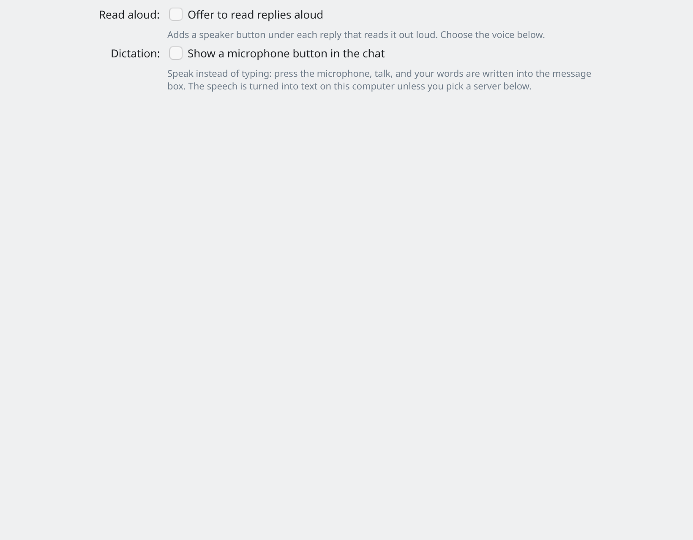

# Voice

**Dictation** (talk instead of typing) and **read aloud** (the widget speaks the replies) are both **off by default**. Switch them on in **Settings → Voice**.

The widget does not install or run speech models itself. The speech is done by a separate app, **Speech Note**.

*Settings → Voice.*

## Speech Note (recommended)

[Speech Note](https://github.com/mkiol/dsnote) by Michał Kosciesza (MPL-2.0) does the listening and the speaking, in any language you download a model for.

1. **Install it.** From Flathub: [net.mkiol.SpeechNote](https://flathub.org/apps/net.mkiol.SpeechNote), or from your distribution's package.
2. **Open Speech Note once** and download a **speech-to-text** model (for dictation) and a **voice** (for read aloud) in your language. The languages and models are chosen in Speech Note, not in the widget.
3. In the widget's **Settings → Voice**, switch on **Dictation** and/or **Read aloud**. Speech Note is the default engine. If you don't want Speech Note's own default model or voice, pick one in the **Speech model** and **Voice** lists. Each name shows its language.

Settings → Voice shows whether Speech Note is installed. **Say Hello** (read aloud) and **Test** (dictation) try your settings. It says "Speech Note has no speech-to-text model yet" or "no voice yet" if you still need to download one. Until you have a voice in Speech Note (or while it isn't installed), replies are read with the system voice.

*Settings → Voice with Speech Note as the engine.*

### Graphics card

Speech Note can use your graphics card (NVIDIA, AMD, Vulkan) to be much faster. That support belongs to Speech Note, not to this widget. With the Flatpak version, the graphics-card support may come as separate add-ons; Speech Note's own page explains how to install them.

### The first start takes a moment

Speech Note starts when you dictate or read, and stops by itself when idle. The first press after a while shows "Starting Speech Note..." while it loads its model. Please wait for it. **Keep ready** (in Settings → Voice) chooses how long Speech Note stays ready after you close the chat, so the next press starts at once. While it is ready, its speech model stays in memory (and in the graphics card's memory). "Only when used" frees it after about a minute.

## Dictation

- Switch on **Dictation**, then **Show a microphone button in the chat**.
- Press the microphone, talk, and press it again (Stop). Your words are written into the message box. **Esc** drops what you said.
- **Send the transcript right away**: on, your words are sent as soon as you stop; off, they wait in the message box so you can check them first.
- **Spoken language**: "Detect automatically" works for most people. Choosing yours helps with short phrases.

## Read aloud

- Switch on **Read aloud** and **Offer to read replies aloud** to get a speaker button under each reply.
- **Ctrl+Shift+S** reads the selected text, otherwise the picked message, otherwise the last reply; press it again to stop. Right-click selected text in a message to choose Read aloud.
- While a message is read aloud, the sentence being read glows and the glow moves along. With the system voice the word being said glows a little brighter. The glow never changes what you have selected.
- **Read every reply aloud when it is finished** speaks each new reply by itself. Stop it with the stop button or Ctrl+Shift+S.
- **Say Hello** plays a short greeting with your settings, so you can hear them before saving.

## Other engines

- **System voices** (read aloud only): Qt's text-to-speech through Speech Dispatcher (`speech-dispatcher` and, for a voice, `espeak-ng`). It reads until Speech Note is installed and has a voice. Nothing to set up, but it sounds robotic.
- **Speech server** (OpenAI-compatible): any server with `/audio/transcriptions` (dictation) or `/audio/speech` (read aloud), such as a Whisper or Kokoro server on your computer, Groq or OpenAI. Enter its address in Settings → Voice. Its key is kept in KWallet (**Save key** / **Remove key**). **Test** sends a short recording that comes with the widget; no microphone needed. For dictation with a server, the microphone is recorded with `pw-record` (PipeWire), `parecord` or `arecord`, and the recording is sent to that server. Read-aloud text is sent to the server too. Use a server you trust (see [Privacy](privacy.md)).

## Coming from an earlier build

The widget's own speech models and engines are gone: faster-whisper, whisper.cpp, Parakeet, Kokoro, Flite, Piper and the custom-command engine. A saved choice of one of them becomes Speech Note, and read aloud uses the system voice until Speech Note is installed and has a voice. Their old background services are removed at the first start. Their programs and models stay on disk until you delete them in **Settings → Storage → Old voice engines** (it asks first and shows how much space it frees).

## Credit

Speech, models and GPU support by [Speech Note](https://github.com/mkiol/dsnote), © Michał Kosciesza, MPL-2.0.

Something not working? See [Troubleshooting](troubleshooting.md).
